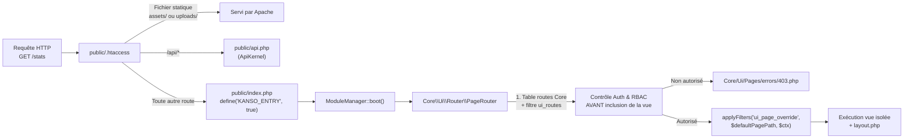

# Architecture Cible V2 — Refactorisation Arborescence, Modules & Verrouillage Sécurité

**Projet :** Kanso-ya CMS Associatif  
**Rôle :** @architect (Architecture Logicielle & Sécurité)  
**Statut :** Spécification d'Architecture Cible (Avant exécution des lots R0–R7)  
**Date :** 21 novembre 2026  
**Documents liés :** [`ARCHITECTURE.md`](./ARCHITECTURE.md) (référentiel actuel v1.1) · [`ETAT-DES-LIEUX.md`](./ETAT-DES-LIEUX.md) (bilan @cp)

---

## 1. Objectifs de la Refactorisation V2

La V2 répond à quatre exigences critiques pour le passage en production Linux / mutualisé et l'ouverture à un écosystème de modules tiers :

1. **Conformité PSR-4 stricte et sensibilité à la casse (Linux/Production) :** aligner exactement la casse des dossiers sur celle des namespaces PHP (`Core\Api\…`, `Core\Ui\…`, `Modules\…`).
2. **Surface d'exposition HTTP minimale :** ne laisser dans `/public/` que deux points d'entrée PHP (`index.php` et `api.php`), `.htaccess` et les assets statiques (`assets/`, `uploads/`). Toute vue métier et toute logique PHP vit hors du `DocumentRoot`.
3. **Séparation stricte Api / Ui pour le Core et les Modules :** isoler la logique métier (`{NomModule}Api`) de la présentation (`{NomModule}Ui`) et offrir un système de surcharge UI fin via `EventManager`.
4. **Défense en profondeur (Verrouillage Sécurité) :** interdire par `.htaccess` (racine, `/public/`, `/public/uploads/`, `/storage/private_uploads/`) et par garde applicative (`KANSO_ENTRY`) tout accès direct aux fichiers internes, et conditionner strictement les hooks QA à l'environnement de test.

---

## 2. Arborescence Stricte PSR-4 (Sensible à la Casse Linux)

### 2.1. Vue d'Ensemble de la Cible

```text
kanso-ya/
├── .env                                    # Variables d'environnement (APP_ENV, DB_*, SUPERADMIN_URL, QA_HOOKS_ENABLED)
├── .htaccess                               # Verrouillage racine (interdit Core/, modules/, storage/, docs/, tests/, vendor/, .env)
├── composer.json                           # Autoload PSR-4 strict : Core\ -> Core/, Modules\ -> modules/
├── package.json                            # Scripts build:ts, build:css, db:reset, test:e2e
├── tailwind.config.js                      # Scanning Core/Ui/** et modules/*Ui/** (remplace le CDN)
├── tsconfig.json                           # Compilation Core/Ui/ts/ -> public/assets/ts/
│
├── Core/                                   # NOYAU APPLICATIF (strictement hors accès HTTP)
│   ├── Api/                                # COUCHE BACKEND UNIQUEMENT (namespace Core\Api\*)
│   │   ├── Database/
│   │   │   ├── Database.php                # Singleton PDO SQLite WAL / MySQL + transactions BEGIN IMMEDIATE
│   │   │   └── Migrations/
│   │   │       ├── 001_core_schema.php
│   │   │       ├── 002_core_seed.php
│   │   │       └── 003_modules_schema.php
│   │   ├── Endpoints/                      # Contrôleurs REST JSend HTTP 200
│   │   │   ├── AuthController.php
│   │   │   ├── CmsController.php
│   │   │   ├── DisciplineController.php
│   │   │   ├── MemberController.php
│   │   │   ├── RegistrationController.php
│   │   │   ├── RoleController.php
│   │   │   └── SystemController.php
│   │   ├── Http/                           # Infrastructure API extraite de public/api.php
│   │   │   ├── ApiKernel.php               # Bootstrap, shutdown handler, sendJson(), CSRF, CORS/headers
│   │   │   ├── ApiRouter.php               # Matching méthode/URI + dispatch Core + routes modules
│   │   │   └── Routes/
│   │   │       └── CoreApiRoutes.php       # Déclaration centralisée des routes /api/v1/*
│   │   ├── Middleware/
│   │   │   └── AuthMiddleware.php          # Sessions, RBAC, isolation Superadmin (hooks QA conditionnés APP_ENV)
│   │   ├── Services/                       # Services métier purs (sans rendu HTML)
│   │   │   ├── ModuleManager.php           # Cycle de vie + Safe Mode (boot + filtres)
│   │   │   ├── ModuleScanner.php           # Détection modules/{Nom}Api/manifest.json
│   │   │   ├── RolloverService.php         # Bascule annuelle de saison
│   │   │   ├── ScheduleService.php         # Requêtes extraites de horaires.php
│   │   │   └── StatsService.php            # Requêtes extraites de stats.php
│   │   └── Sdk/                            # SDK déplacé dans Core\Api\Sdk
│   │       ├── EventManager.php            # Bus Actions & Filtres (avec attribution module pour Safe Mode)
│   │       ├── ModuleInterface.php         # Contrat install(), uninstall(), boot(EventManager)
│   │       └── UiHelpers.php               # Helpers globaux ui_text(), ui_slot(), ui_tabs()
│   │
│   └── Ui/                                 # COUCHE FRONTEND UNIQUEMENT (namespace Core\Ui\*)
│       ├── Router/
│       │   └── PageRouter.php              # Routage unique public/index.php -> Core/Ui/Pages/* + ui_page_override
│       ├── Templates/
│       │   └── layout.php                  # Gabarit maître Holy Grail (garde KANSO_ENTRY, zéro SQL direct)
│       ├── Components/
│       │   └── feedback.php                # Modales de confirmation & conteneur Toasts
│       ├── Pages/                          # Vues internes (anciennement public/*.php — NON accessibles en HTTP)
│       │   ├── home.php                    # Route /
│       │   ├── login.php                   # Route /login
│       │   ├── register.php                # Route /register
│       │   ├── activate-otp.php            # Route /activate-otp
│       │   ├── health-check.php            # Route /questionnaire-sante
│       │   ├── horaires.php                # Route /horaires
│       │   ├── legal.php                   # Routes /rgpd, /cgv, /mentions-legales
│       │   ├── dashboard.php               # Route /dashboard
│       │   ├── settings.php                # Route /settings
│       │   ├── stats.php                   # Route /stats
│       │   ├── members.php                 # Route /members
│       │   ├── registrations.php           # Route /registrations
│       │   ├── cms.php                     # Route /cms
│       │   ├── disciplines.php             # Route /disciplines
│       │   ├── roles.php                   # Route /roles
│       │   ├── sys-admin-login.php         # Route /{SUPERADMIN_URL} (ex: /sys-admin-xyz)
│       │   ├── sys-console.php             # Route /sys-console
│       │   ├── sys-branding.php            # Route /sys-branding
│       │   ├── sys-smtp.php                # Route /sys-smtp
│       │   ├── sys-modules.php             # Route /sys-modules
│       │   ├── sys-logs.php                # Route /sys-logs
│       │   └── errors/
│       │       ├── 403.php                 # Vue Accès Refusé standardisée
│       │       └── 404.php                 # Vue Page Introuvable standardisée
│       └── ts/                             # Sources TypeScript strictes (compilées vers public/assets/ts/)
│           ├── api.ts
│           ├── main.ts
│           └── … (tous les modules TS existants)
│
├── modules/                                # MODULES TIERS & EXTENSIONS (hors accès HTTP)
│   ├── BoutiqueApi/                        # Backend du module Boutique
│   ├── BoutiqueUi/                         # Frontend du module Boutique
│   ├── CrashTestApi/                       # Module démonstrateur Safe Mode
│   └── IncompatibleModuleApi/              # Module démonstrateur rejet compatibilité
│
├── public/                                 # DOCUMENT ROOT WEB (SEUL DOSSIER EXPOSÉ EN HTTP)
│   ├── .htaccess                           # Routage unique vers index.php / api.php + blocage .php directs
│   ├── index.php                           # Front-Controller UI unique (définit KANSO_ENTRY, invoque PageRouter)
│   ├── api.php                             # Front-Controller API unique (définit KANSO_API, invoque ApiKernel)
│   ├── assets/
│   │   ├── css/tailwind.css                # CSS compilé (sans dépendance CDN)
│   │   ├── ts/                             # ES Modules compilés du Core
│   │   └── modules/                        # Assets statiques publiés des modules actifs ({slug}/)
│   └── uploads/
│       ├── .htaccess                       # Interdiction stricte d'exécution de scripts
│       └── branding/                       # Logos, filigranes et médias publics autorisés
│
├── storage/                                # STOCKAGE PRIVÉ PERSISTANT (hors accès HTTP)
│   ├── backups/                            # Sauvegardes SQLite (avec politique de rétention)
│   ├── db/kanso-ya.sqlite                  # Base SQLite WAL
│   └── private_uploads/                    # Certificats médicaux (.htaccess Require all denied)
│
├── docs/                                   # Documentation (non exposée)
└── tests/                                  # Suites Playwright E2E (non exposées)
```

### 2.2. Mapping Autoloader PSR-4 (`composer.json`) & Précaution Windows/Git

```json
{
    "autoload": {
        "psr-4": {
            "Core\\": "Core/",
            "Modules\\": "modules/"
        }
    }
}
```

> [!WARNING]
> **Sensibilité à la casse sur Windows (NTFS) :** Git sur Windows ignore parfois un renommage uniquement basé sur la casse (`core` → `Core`). Lors du lot R1, tout renommage devra s'effectuer en **deux étapes explicites** :
> `git mv core Core_tmp && git mv Core_tmp Core` (idem pour `ui` → `Ui`, `templates` → `Templates`, `components` → `Components`, `migrations` → `Migrations`), puis vérifié par `composer dump-autoload -o --strict-psr` (0 classe ignorée).

### 2.3. Cycle de Vie d'une Requête UI (`public/index.php` → `PageRouter`)



**Bénéfice sécurité direct :** le contrôle d'authentification et de permissions s'exécute **avant** tout chargement de vue ou de service métier — éliminant définitivement les fallbacks dangereux `$_SESSION['role_name'] ?? 'Président'` présents en v1.1.

---

## 3. Structure Normalisée des Modules (`{NomModule}Api` / `{NomModule}Ui`)

Chaque module applicatif est découpé en **deux dossiers frères** dans `/modules/` suivant exactement la même discipline que le Core :

```text
modules/
├── {NomModule}Api/                         # Obligatoire — Logique métier, BDD & Manifeste
│   ├── manifest.json                       # Métadonnées, compatibilité, déclaration des routes & assets
│   ├── Module.php                          # Classe Modules\{NomModule}Api\Module implements Core\Api\Sdk\ModuleInterface
│   ├── Endpoints/                          # Contrôleurs API REST du module (JSend HTTP 200)
│   ├── Services/                           # Services métier du module
│   └── Migrations/                         # Scripts SQL créant exclusivement des tables mod_{slug}_*
│
└── {NomModule}Ui/                          # Optionnel (si le module possède une interface)
    ├── Pages/                              # Vues PHP du module (protégées par KANSO_ENTRY)
    ├── Components/                         # Partials/blocs injectables via ui_slot_*
    └── ts/                                 # Sources TypeScript du module (compilées vers dist/ puis publiées)
```

### 3.1. Contrat `manifest.json` (Schéma v2)

```json
{
    "schema_version": 2,
    "id": "boutique",
    "name": "Boutique Officielle du Club",
    "version": "2.0.0",
    "author": "Kanso-ya Team",
    "description": "Gestion des équipements sportifs et commandes adhérents.",
    "namespace": "Modules\\BoutiqueApi",
    "entry_class": "Modules\\BoutiqueApi\\Module",
    "ui_folder": "BoutiqueUi",
    "compatibility": {
        "core_min": "2.0.0",
        "php_min": "8.5.0"
    },
    "tables_prefix": "mod_boutique_",
    "assets": {
        "publish_dir": "BoutiqueUi/dist",
        "public_slug": "boutique"
    }
}
```

### 3.2. Règles d'Isolation des Modules

1. **Zéro fichier de module dans `/public/` :** un module ne dépose jamais de fichier `.php` dans `/public/` (fin de `public/boutique.php`). Ses pages sont enregistrées via le filtre `ui_routes` et servies par `public/index.php` → `PageRouter`.
2. **Assets statiques publiés :** à l'activation d'un module, `ModuleManager` copie (ou lie) les fichiers autorisés (`.js`, `.css`, `.svg`, `.png`, `.webp`) de `modules/{NomModule}Ui/dist/` vers `public/assets/modules/{slug}/` et les supprime à la désinstallation. Aucun `.php` n'est jamais copié.
3. **Préfixage BDD obligatoire :** toute table créée dans `install()` commence par `mod_{slug}_`. `uninstall()` nettoie exclusivement ces tables.
4. **Rétrocompatibilité de scan :** `ModuleScanner` reconnaît les dossiers `*Api` (prioritaire V2) et rejette avec un statut explicite tout manifeste invalide ou incompatible.

---

## 4. Système de Surcharge UI via `EventManager`

Le bus d'événements est déplacé vers `Core\Api\Sdk\EventManager` (un alias de classe `Core\Sdk\EventManager` peut être maintenu durant la transition si nécessaire). Il expose des **points d'extension UI normalisés** consommés par `PageRouter`, `layout.php` et les vues de `Core/Ui/Pages/`.

### 4.1. Catalogue des Filtres UI Officiels

| Filtre | Valeur initiale (`$value`) | Contexte (`$context`) | Cas d'usage |
|---|---|---|---|
| **`ui_text`** | `string` (texte par défaut) | `['key' => string, 'page' => string, 'role' => string, 'params' => array]` | Surcharger un titre, un libellé de bouton, un message d'accueil ou un texte d'aide sans modifier le Core. |
| **`ui_tabs`** | `array<int, array{id: string, label: string, active?: bool, permission?: ?string, view?: string, content?: string, order?: int}>` | `['page' => string, 'role' => string, 'user_id' => int]` | Ajouter, renommer, réordonner ou remplacer un onglet sur toute page à onglets (`stats`, `sys-smtp`, `dashboard`, `settings`, etc.). |
| **`stats_tabs`** | *(alias rétrocompatible de `ui_tabs` avec `page = 'stats'`)* | `['role' => string, 'user_id' => int]` | Préserve 100 % de compatibilité avec les modules existants. |
| **`ui_page_override`** | `string` (chemin absolu de la vue Core par défaut) | `['route' => string, 'page_id' => string, 'role' => string, 'params' => array]` | Remplacer intégralement une page du Core par une vue dans `modules/{NomModule}Ui/Pages/`. |
| **`ui_slot_{zone}`** | `string` (HTML accumulé, `''` par défaut) | `['page' => string, 'role' => string, 'data' => array]` | Injecter un bloc/widget dans une zone prédéfinie (`ui_slot_home_hero`, `ui_slot_home_after_articles`, `ui_slot_dashboard_top`, `ui_slot_dashboard_bottom`, `ui_slot_member_detail`, `ui_slot_footer_links`). |
| **`ui_routes`** | `array<string, array{page: string, auth?: bool, perms?: string[], superadmin_only?: bool}>` | `['role' => string]` | Déclarer de nouvelles routes propres côté module (ex. `/boutique`). |
| **`api_routes`** | `array<int, array{method: string, pattern: string, handler: callable, perms?: string[]}>` | `[]` | Déclarer des endpoints REST module sous `/api/v1/modules/{slug}/*` (toujours encapsulés JSend HTTP 200). |
| **`admin_sidebar_menu`** | `array<int, array{id: string, label: string, url: string, icon?: string, permission?: ?string}>` | `['role' => string, 'is_superadmin' => bool]` | Injecter ou réorganiser les entrées de la Sidebar. |
| **`ui_assets`** | `array{scripts: string[], styles: string[]}` | `['page' => string]` | Charger un script ES module ou une feuille de style publiée dans `/assets/modules/{slug}/`. |

### 4.2. Helpers Ergonomiques (`Core\Api\Sdk\UiHelpers`)

Pour garder les vues de `Core/Ui/Pages/` lisibles et concises :

```php
// Surcharge de texte (échappé automatiquement par défaut)
echo ui_text('home.hero.title', 'Bienvenue au Dojo Kanso-ya', ['page' => 'home']);

// Injection d'un slot (les blocs injectés sont concaténés par priorité)
echo ui_slot('dashboard_top', ['user_id' => $currentUserId, 'role' => $currentRole]);

// Résolution des onglets d'une page
$tabs = ui_tabs('stats', $defaultTabs, ['role' => $currentRole, 'user_id' => $currentUserId]);
```

### 4.3. Sécurité & Safe Mode des Surcharges UI

1. **Liste blanche de chemins sur `ui_page_override` :** `PageRouter` vérifie via `realpath()` que le fichier retourné par un module réside strictement dans `/Core/Ui/Pages/` ou `/modules/*Ui/Pages/` et se termine par `.php`. Toute tentative de traversée (`../`) est rejetée et journalisée dans `sys_logs`, avec repli automatique sur la vue Core.
2. **Attribution de module dans `EventManager` :** lors du `ModuleManager::boot()`, `EventManager::setCurrentModule($folderName)` étiquette automatiquement chaque action/filtre enregistré par le module.
3. **Safe Mode étendu à l'exécution des filtres :** si un callback de filtre (`ui_text`, `ui_tabs`, `ui_page_override`, `ui_slot_*`) lève une `Throwable`, `EventManager` :
   - capture l'exception et retourne la valeur précédente intacte (zéro écran blanc, HTTP 200 garanti) ;
   - notifie `ModuleManager::quarantineModule($moduleName, $e)` qui bascule immédiatement le module en `status = 'crashed'`, `is_active = 0` et écrit `MODULE_SAFE_MODE_TRIGGERED` dans `sys_logs`.

---

## 5. Verrouillage de Sécurité Multi-Couches

### 5.1. Couche 1 — `.htaccess` à la Racine du Projet (`/kanso-ya/.htaccess`)

Protège l'application **même si un hébergeur mutualisé pointe le DocumentRoot sur la racine du projet** au lieu de `/public/` :

```apache
# ==============================================================================
# KANSO-YA V2 — VERROUILLAGE RACINE (Défense en profondeur mutualisé / VPS)
# ==============================================================================
Options -Indexes -MultiViews
ServerSignature Off

<IfModule mod_rewrite.c>
    RewriteEngine On

    # 1. Interdiction absolue d'accès HTTP direct aux répertoires internes et sensibles
    RewriteRule ^(Core|core|modules|storage|docs|tests|vendor|node_modules|src|allure-results|error-reports|test-results)(/|$) - [F,L,NC]

    # 2. Interdiction d'accès aux fichiers cachés (.env, .git, .htaccess) et fichiers de build/config
    RewriteRule ^\. - [F,L]
    RewriteRule ^(composer\.(json|lock)|package(-lock)?\.json|playwright\.config\.ts|tsconfig\.json|tailwind\.config\.js|AGENTS\.md|license)$ - [F,L,NC]

    # 3. Si le DocumentRoot pointe par erreur sur la racine, rediriger silencieusement vers /public/
    RewriteCond %{REQUEST_URI} !^/public/
    RewriteRule ^(.*)$ public/$1 [L]
</IfModule>

<IfModule !mod_rewrite.c>
    <IfModule mod_authz_core.c>
        Require all denied
    </IfModule>
</IfModule>
```

### 5.2. Couche 2 — `.htaccess` dans `/public/` (`/kanso-ya/public/.htaccess`)

Point d'entrée unique : **seuls `index.php` et `api.php` sont exécutables**, tout accès direct à un autre `.php` est bloqué en 403, et les en-têtes de sécurité HTTP sont injectés systématiquement :

```apache
# ==============================================================================
# KANSO-YA V2 — FRONT-CONTROLLER UNIQUE & VERROUILLAGE /public/
# ==============================================================================
Options -Indexes -MultiViews
DirectoryIndex index.php

# En-têtes de sécurité HTTP
<IfModule mod_headers.c>
    Header always set X-Content-Type-Options "nosniff"
    Header always set X-Frame-Options "SAMEORIGIN"
    Header always set Referrer-Policy "strict-origin-when-cross-origin"
    Header always set Permissions-Policy "geolocation=(), microphone=(), camera=()"
</IfModule>

# Blocage des fichiers cachés (.htaccess, .env, etc.)
<FilesMatch "^\.">
    <IfModule mod_authz_core.c>
        Require all denied
    </IfModule>
</FilesMatch>

<IfModule mod_rewrite.c>
    RewriteEngine On
    RewriteBase /

    # 1. Préservation de l'en-tête Authorization pour l'API REST
    SetEnvIf Authorization "(.*)" HTTP_AUTHORIZATION=$1

    # 2. Blocage strict de tout accès direct à un fichier .php hors index.php et api.php
    #    (Empêche l'exécution directe d'un éventuel .php déposé par erreur dans /public/)
    RewriteCond %{THE_REQUEST} \s/+[^\s?]*\.php[\s?] [NC]
    RewriteCond %{REQUEST_URI} !^/(index|api)\.php$ [NC]
    RewriteRule \.php$ - [F,L,NC]

    # 3. Interdiction de toute tentative d'accès à des segments internes via /public/
    RewriteRule ^(Core|core|modules|storage|docs|tests|vendor)(/|$) - [F,L,NC]

    # 4. Trafic API -> Front-Controller API unique
    RewriteCond %{REQUEST_URI} ^/api(/|$) [NC]
    RewriteRule ^(.*)$ api.php [L,QSA]

    # 5. Assets statiques existants (assets/, uploads/, favicon.ico, robots.txt) servis directement
    RewriteCond %{REQUEST_FILENAME} -f
    RewriteCond %{REQUEST_URI} \.(css|js|map|png|jpe?g|gif|webp|svg|ico|woff2?|ttf|mp4|webm|txt)$ [NC]
    RewriteRule ^ - [L]

    # 6. Tout le reste -> Front-Controller UI unique (PageRouter)
    RewriteRule ^ index.php [L,QSA]
</IfModule>
```

> [!NOTE]
> **Transition douce des URLs `.php` legacy (optionnelle durant le lot R2) :** si des favoris utilisateurs ou d'anciens tests appellent encore `/stats.php` ou `/members.php`, une phase transitoire peut émettre une redirection `301` vers `/stats` avant d'activer le `403` définitif au lot R5 (une fois les tests E2E migrés sur les URLs propres).

### 5.3. Couche 3 — `.htaccess` dans `/public/uploads/` et `/storage/private_uploads/`

- **`/public/uploads/.htaccess` :** interdit toute exécution de code (défense en profondeur en cas de contournement d'upload) :
  ```apache
  Options -Indexes -ExecCGI
  <FilesMatch "\.(php|phtml|php3|php4|php5|phar|pl|py|cgi|sh)$">
      <IfModule mod_authz_core.c>
          Require all denied
      </IfModule>
  </FilesMatch>
  ```
- **`/storage/private_uploads/.htaccess` :** conservé en `Require all denied` (accès exclusivement via endpoint authentifié PHP avec contrôle RBAC).

### 5.4. Couche 4 — Garde Applicative & Isolation des Hooks QA

1. **Constante de garde `KANSO_ENTRY` :**
   - `public/index.php` définit `define('KANSO_ENTRY', true);` ; `public/api.php` définit `define('KANSO_API', true);`.
   - Chaque vue de `Core/Ui/Pages/`, `Core/Ui/Templates/`, `Core/Ui/Components/` et `modules/*Ui/` débute par :
     ```php
     if (!defined('KANSO_ENTRY')) {
         http_response_code(403);
         exit('Direct access forbidden.');
     }
     ```
2. **Verrouillage des hooks QA (`switch-persona`, `stub-*-token`) :**
   - Désactivés par défaut.
   - Activés **uniquement** lorsque **les deux** variables d'environnement suivantes sont réunies :
     `APP_ENV=testing` **ET** `QA_HOOKS_ENABLED=1` (vérifié dans `AuthMiddleware` avant tout routage).
   - En `APP_ENV=production`, `POST /api/v1/auth/switch-persona` renvoie JSend `404` et les jetons `stub-*` sont ignorés.
3. **Équivalent Nginx (documentation déploiement) :**
   - `location ~ ^/(Core|modules|storage|docs|tests|vendor)/ { deny all; }`
   - `location ~ /\.(?!well-known) { deny all; }`
   - `location ~ ^/uploads/.*\.php$ { deny all; }`
   - `location ~ \.php$ { ... }` restreint exclusivement à `= /index.php` et `= /api.php`.

---

## 6. Stratégie de Migration Incrémentale & Critères de Validation

| Lot | Périmètre | Validation bloquante avant passage au lot suivant |
|---|---|---|
| **R0** | Verrouillage hooks QA (`APP_ENV=testing` + `QA_HOOKS_ENABLED=1`), suppression fallbacks `?? 'Président'`, `.htaccess` racine + `public/uploads/.htaccess` + en-têtes HTTP. | `npm run test:e2e` 100 % vert + test direct `switch-persona` bloqué hors `testing`. |
| **R1** | Renommages PSR-4 sensibles à la casse (`Core/Api`, `Core/Ui`, `Core/Api/Sdk`), éclatement `api.php` (`ApiKernel`/`ApiRouter`), extraction SQL des vues vers `StatsService` & `ScheduleService`. | `composer dump-autoload -o --strict-psr` (0 warning) + PHPStan + `build:ts` + E2E 100 %. |
| **R2** | Déplacement des 21 pages de `public/*.php` vers `Core/Ui/Pages/`, création de `Core/Ui/Router/PageRouter`, `public/index.php` Front-Controller unique, contrôle Auth/RBAC pré-rendu. | E2E 100 % (URLs propres) + `public/` ne contient plus que `index.php` et `api.php`. |
| **R3** | Migration modules vers `modules/{Nom}Api` & `modules/{Nom}Ui`, manifeste v2, publication d'assets vers `public/assets/modules/{slug}/`, suppression de `public/boutique.php`. | `07-sprint6-modules-sdk.spec.ts` + E2E 100 %. |
| **R4** | Implémentation `ui_text`, `ui_tabs` (+ alias `stats_tabs`), `ui_page_override`, `ui_slot_*`, `ui_routes`, `ui_assets` + Safe Mode étendu aux filtres. | Nouvelle suite E2E dédiée aux hooks de surcharge UI & Safe Mode filtre. |
| **R5** | Activation `.htaccess` stricts (blocage `403` de tout `.php` direct hors `index.php`/`api.php`), garde `KANSO_ENTRY`, tests E2E de pénétration HTTP directe. | Nouvelle suite E2E sécurité : 403/404 garantis sur `/Core/`, `/modules/`, `/storage/`, `/.env`, `/stats.php`, `/uploads/test.php`. |
| **R6** | `tailwind.config.js` réel + retrait CDN Tailwind, montée PHPStan niveau 5, nettoyage `storage/backups/` (rétention). | `build:css` non vide, PHPStan L5 = 0 erreur, E2E 100 %. |
| **R7** | Mise à jour finale `ARCHITECTURE.md` (passage V2 en référence active), rédaction `docs/SDK-MODULES.md` & guide de déploiement. | Relecture croisée @cp / @architect. |
