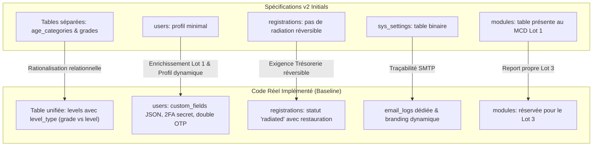

# Document d'Architecture Technique & Référentiel Système (ARCHITECTURE.md)

**Projet :** Kanso-ya CMS Associatif (Core)  
**Rôle :** @architect (Architecture Logicielle & Référentiel Technique)  
**Statut :** Référence Officielle de Production (Baseline Post-Lot 2)  
**Dernière révision :** 16 novembre 2026

---

## 1. Vision, Principes Directeurs & Stack Technologique

Le projet **Kanso-ya** est un système de gestion intégrée (CMS & CRM) conçu spécifiquement pour les clubs sportifs et associations (ex: dojos d'arts martiaux, clubs omnisports). Il allie légèreté extrême, résilience, sécurité stricte et extensibilité modulaire.

### 1.1. La Stack Technique Réelle

- **Environnement Serveur Local :** Laragon sur Windows (`https://kanso-ya.fr`, vHost Apache avec SSL auto-signé).
- **Backend Core :** PHP 8.5+ natif, typage strict (`declare(strict_types=1)`), Programmation Orientée Objet sans framework lourd (pas de Symfony/Laravel) afin de garantir une empreinte mémoire minimale (< 10 Mo) et une vitesse d'exécution instantanée.
- **Base de Données :** Abstraction PDO via le Singleton `Core\Api\Database\Database`. Moteur principal : **SQLite 3 en mode WAL** (`storage/db/kanso_ya.sqlite`) avec configuration anti-verrouillage :
  - `PRAGMA busy_timeout = 15000;` (15 secondes d'attente active avant timeout) ;
  - `PRAGMA journal_mode = WAL;` (Write-Ahead Logging pour lecture/écriture concurrentes) ;
  - `PRAGMA synchronous = NORMAL;`.
  - Support de bascule vers MySQL/MariaDB prévu via variables d'environnement dans `.env`.
- **Frontend & Architecture Graphique :**
  - **Architecture MPA (Multi-Page Application) :** Chaque vue métier possède son fichier d'entrée physique dans `public/*.php`, garantissant le référencement, la lisibilité des URLs et l'étanchéité des contextes.
  - **Moteur Graphique :** Tailwind CSS (compilé via `npm run build:css` depuis `src/input.css` vers `public/assets/css/tailwind.css` et secouru par CDN en développement).
  - **Logique Client :** TypeScript natif strict (`core/ui/ts/`) compilé vers des modules ES natifs (`public/assets/ts/`) exécutés directement par le navigateur (`<script type="module">`). Aucun bundler opaque (pas de Webpack/Vite obligatoire pour l'exécution).

---

## 2. Arborescence Réelle du Code Source

```text
c:\laragon\www\kanso-ya/
├── .env                                  # Configuration d'environnement (DB, SMTP, URL secrète)
├── .gitignore
├── composer.json                         # Dépendances PHP (PHPStan, PHPUnit)
├── package.json                          # Scripts de build (TS, CSS, Playwright, Allure)
├── playwright.config.ts                  # Configuration des tests E2E multi-navigateurs
├── tailwind.config.js                    # Thème Tailwind et scanning des templates
├── tsconfig.json                         # Compilation TypeScript stricte
│
├── core/                                 # Noyau applicatif protégé (hors DocumentRoot)
│   ├── Api/                              # Couche Backend REST
│   │   ├── Database/                     # Persistance & Migrations
│   │   │   ├── Database.php              # Singleton PDO Hybride (SQLite/MySQL)
│   │   │   └── migrations/
│   │   │       ├── 001_core_schema.php   # Schéma relationnel complet du Core
│   │   │       └── 002_core_seed.php     # Jeu de données d'amorce (Fixtures & QA)
│   │   ├── Endpoints/                    # Contrôleurs métier REST
│   │   │   ├── AuthController.php        # Authentification standard, Superadmin, 2FA & profil
│   │   │   ├── CmsController.php         # Articles, médias, catégories & pages légales
│   │   │   ├── DisciplineController.php  # Disciplines, grades d'âge & niveaux (ceintures)
│   │   │   ├── MemberController.php      # CRM adhérents, fiches médicales & renvoi OTP
│   │   │   ├── RegistrationController.php# Panier familial, trésorerie & validation bureau
│   │   │   ├── RoleController.php        # Matrice RBAC multi-colonnes dynamique
│   │   │   └── SystemController.php      # Console système, branding, SMTP & logs d'audit
│   │   └── Middleware/
│   │       └── AuthMiddleware.php        # Vérification des habilitations et sessions
│   │
│   └── ui/                               # Rendu Frontend & Templates serveur
│       ├── components/                   # Partials PHP réutilisables (feedback.php, etc.)
│       ├── templates/
│       │   └── layout.php                # Gabarit Maître Holy Grail (Header, Sidebar, Toasts)
│       └── ts/                           # Sources TypeScript client (Mode strict)
│           ├── api.ts                    # Wrapper fetch (Injection CSRF, Enveloppe JSend)
│           ├── cms.ts                    # Builder Studio CMS (2 onglets, multi-colonnes, modal aperçu)
│           ├── dashboard.ts              # Widgets du tableau de bord utilisateur
│           ├── disciplines.ts            # Gestion des disciplines et niveaux
│           ├── home.ts                   # Vitrine publique (articles publiés)
│           ├── login.ts                  # Formulaire de login standard
│           ├── main.ts                   # Layout global, tiroir mobile & moteur de Toasts
│           ├── members.ts                # CRM adhérents (accordéons tuteurs, filtres instantanés)
│           ├── register.ts               # Wizard d'inscription public adaptatif (mineur/majeur)
│           ├── registrations.ts          # Trésorerie (validation, radiation réversible, reçus)
│           ├── roles.ts                  # Tableau unique multi-colonnes RBAC
│           ├── sys-console.ts            # Console Superadmin (Branding, SMTP, logs système)
│           └── sys-login.ts              # Formulaire de Shadow Login Superadmin
│
├── docs/                                 # Documentation technique et agile
│   ├── ARCHITECTURE.md                   # Le présent document d'architecture technique
│   ├── ROADMAP.md                        # Feuille de route et découpage agile du Lot 3
│   ├── current-sprint/                   # Rapports de recette du sprint actif
│   │   └── 04-qa-report.md
│   └── sources-v2/                       # Documents de spécifications et MCD initiaux
│
├── error-reports/                        # Rapports d'anomalies générés par Playwright
├── modules/                              # Répertoire cible du Moteur de Modules SDK (Lot 3)
│
├── public/                               # Document Root Web (Seul dossier exposé HTTP)
│   ├── .htaccess                         # Réécriture d'URL et protection des fichiers
│   ├── activate-otp.php                  # Page publique d'activation de mot de passe par OTP
│   ├── api.php                           # Routeur d'API REST unique (JSend HTTP 200)
│   ├── cms.php                           # Studio CMS d'édition et publication d'articles
│   ├── dashboard.php                     # Espace connecté (selon rôle)
│   ├── disciplines.php                   # Configuration sportive
│   ├── index.php                         # Vitrine publique du club
│   ├── legal.php                         # Affichage des pages fixes (/rgpd, /cgv)
│   ├── login.php                         # Authentification standard adhérents/bureau
│   ├── members.php                       # Annuaire CRM des adhérents
│   ├── register.php                      # Tunnel d'inscription en ligne
│   ├── registrations.php                 # Gestion de trésorerie & dossiers d'adhésion
│   ├── roles.php                         # Matrice de droits RBAC
│   ├── stats.php                         # Indicateurs statistiques & anonymisation enseignant
│   ├── sys-admin-login.php               # Point d'entrée furtif Superadmin (Shadow Login)
│   ├── sys-console.php                   # Console Superadmin système
│   ├── assets/
│   │   ├── css/tailwind.css              # Feuille de styles compilée
│   │   └── ts/                           # Fichiers JavaScript ES Modules compilés par tsc
│   └── uploads/
│       └── branding/                     # Logos et filigranes publics du club
│
├── storage/                              # Stockage persistant privé (protégé par .htaccess)
│   ├── db/
│   │   └── kanso_ya.sqlite               # Fichier de base de données SQLite
│   └── private_uploads/                  # Certificats médicaux et pièces sensibles
│
└── tests/                                # Automatisation des tests
    ├── e2e/                              # Suites Playwright (TC-LOT1.spec.ts, TC-LOT2.spec.ts)
    ├── reporters/                        # MarkdownErrorReporter personnalisé
    └── setup/                            # global-setup.ts et global-teardown.ts (snapshot BDD)
```

---

## 3. Schéma Relationnel Réel (SQLite) & Résolution des Écarts v2

Le schéma réel de la base est matérialisé dans la migration [`core/Api/Database/migrations/001_core_schema.php`](file:///c:/laragon/www/kanso-ya/core/Api/Database/migrations/001_core_schema.php).

### 3.1. Tableau Synthétique des 15 Tables du Core

|   N°   | Table                | Rôle Métier                                              | Clé Primaire            | Clés Étrangères Principales                                           |
| :----: | :------------------- | :------------------------------------------------------- | :---------------------- | :-------------------------------------------------------------------- |
| **1**  | `sys_superadmins`    | Comptes d'administration système isolés                  | `id` (AUTOINCREMENT)    | Aucune (Isolation totale)                                             |
| **2**  | `sys_settings`       | Configuration clé-valeur (Branding, Couleurs, SMTP)      | `setting_key` (VARCHAR) | Aucune                                                                |
| **3**  | `sys_logs`           | Journal d'audit des actions techniques Superadmin        | `id` (AUTOINCREMENT)    | `superadmin_id` -> `sys_superadmins(id)`                              |
| **4**  | `email_logs`         | Traçabilité des e-mails transactionnels envoyés (SMTP)   | `id` (AUTOINCREMENT)    | Aucune                                                                |
| **5**  | `roles`              | Matrice des rôles club (Tableau Unique Multi-Colonnes)   | `id` (AUTOINCREMENT)    | Aucune                                                                |
| **6**  | `users`              | Comptes utilisateurs applicatifs (Président, Adhérents)  | `id` (AUTOINCREMENT)    | `role_id` -> `roles(id)`                                              |
| **7**  | `app_logs`           | Journal d'audit de la vie du club (Validations, etc.)    | `id` (AUTOINCREMENT)    | `user_id` -> `users(id)`                                              |
| **8**  | `members`            | Fiches des pratiquants (Membres majeurs ou mineurs)      | `id` (AUTOINCREMENT)    | Aucune                                                                |
| **9**  | `member_tutor`       | Rattachements légaux & cloisonnement RGPD                | `(member_id, tutor_id)` | `member_id` -> `members(id)`, `tutor_id` -> `users(id)`               |
| **10** | `registrations`      | Dossiers financiers d'inscription (Panier familial)      | `id` (AUTOINCREMENT)    | `payer_user_id` -> `users(id)`, `validated_by` -> `users(id)`         |
| **11** | `disciplines`        | Référentiel des sports pratiqués (Judo, Karaté, etc.)    | `id` (AUTOINCREMENT)    | `teacher_user_id` -> `users(id)`                                      |
| **12** | `levels`             | Niveaux sportifs : Grades (Âge) & Niveaux (Ceintures)    | `id` (AUTOINCREMENT)    | `discipline_id` -> `disciplines(id)`                                  |
| **13** | `member_practices`   | Pivot Adhérent <-> Pratique sportive & Saison            | `id` (AUTOINCREMENT)    | `member_id` -> `members(id)`, `discipline_id` -> `disciplines(id)`    |
| **14** | `article_categories` | Catégories du blog/actualités avec badge Tailwind        | `id` (AUTOINCREMENT)    | Aucune                                                                |
| **15** | `articles`           | Moteur éditorial CMS (Articles publics, membres, bureau) | `id` (AUTOINCREMENT)    | `category_id` -> `article_categories(id)`, `author_id` -> `users(id)`, `created_by` -> `users(id)`, `updated_by` -> `users(id)` |
| **16** | `pages`              | Pages institutionnelles fixes (`/rgpd`, `/cgv`)          | `id` (AUTOINCREMENT)    | Aucune (`slug` UNIQUE)                                                |

---

### 3.2. Analyse & Résolution des Écarts entre les Spécifications v2 et le Code Réel

Lors de la confrontation entre les documents initiaux dans `/docs/sources-v2/` et le code implémenté dans `001_core_schema.php` et `public/api.php`, plusieurs ajustements d'architecture majeurs ont été actés :



1. **Unification du Référentiel Sportif (`levels`) :**
   - _Spécification v2 :_ Prévoyait deux tables distinctes `age_categories` et `grades`.
   - _Code réel :_ Fusionnées dans la table générique `levels` qui porte une colonne discriminante `level_type` (`'grade'` pour les catégories d'âge U12/U14, `'level'` pour les ceintures de couleur/gants), complétée par `color_hex`, `age_min`, `age_max`, et `rank_order`.
   - _Bénéfice :_ Simplification des jointures dans `member_practices` et uniformisation de l'affichage des badges dans l'annuaire CRM.
2. **Enrichissement de la Table `users` (Sécurité & Profil) :**
   - _Spécification v2 :_ Fiche utilisateur basique.
   - _Code réel :_ Ajout de `first_name`, `last_name`, `phone`, `address`, `custom_fields` (stockage JSON pour champs club arbitraires), `two_factor_enabled`, `two_factor_secret`, `otp_code`, `otp_expires`, `otp_expires_at`, `failed_login_attempts`, `locked_until`.
3. **Traçabilité des E-mails Transactionnels (`email_logs`) :**
   - _Spécification v2 :_ Table non mentionnée au MCD v2 (uniquement `app_logs` et `sys_logs`).
   - _Code réel :_ Création d'une table dédiée `email_logs` pour consigner chaque e-mail expédié par le serveur SMTP avec son type de template, le statut et la réponse du serveur mail distant.
4. **Trésorerie Réversible (`registrations.status`) :**
   - _Spécification v2 :_ Statuts binaires `pending`, `validated`, `cancelled`.
   - _Code réel :_ Prise en compte du statut `'radiated'` permettant de radier un dossier d'inscription tout en conservant la capacité de faire machine arrière ("Restaurer en attente") sans suppression en base.
5. **Gestion de la Table `modules` :**
   - _Spécification v2 :_ Table `modules` mentionnée au MCD v2.
   - _Code réel :_ Volontairement absente de `001_core_schema.php` pour respecter le découpage agile : elle sera introduite lors de la première migration du Lot 3 (Sprint 6).

---

## 4. Standard d'API REST & Protocole JSend HTTP 200

L'ensemble de la communication asynchrone entre le frontend TypeScript et le backend PHP répond à une norme de communication stricte conçue pour éviter toute rupture de protocole.

### 4.1. L'Enveloppe JSend Normalisée

Le serveur backend renvoie **toujours et sans exception un statut réseau HTTP 200 OK**, y compris en cas de refus d'autorisation (403), d'erreur de validation (422) ou d'absence de ressource (404).

Le statut réel de l'opération est encapsulé dans le corps de la réponse JSON :

```json
{
  "status": "success" | "error",
  "success": true | false,
  "code": 200 | 201 | 400 | 401 | 403 | 404 | 422 | 500,
  "message": "Description explicite en français de l'issue de l'opération",
  "data": { ... } | null
}
```

### 4.2. Filet de Sécurité Anti-Crash (`sendJson` & Shutdown Handler)

Dans [`public/api.php`](file:///c:/laragon/www/kanso-ya/public/api.php), deux mécanismes complémentaires garantissent qu'aucune réponse blanche ou mal formée ne puisse être émise :

1. **Nettoyage des buffers (`ob_end_clean()`) :** La fonction `sendJson()` vide les éventuels tampons de sortie avant d'émettre le JSON, empêchant les notices PHP ou les espaces parasites de corrompre le payload.
2. **Gestionnaire de fermeture fatale (`register_shutdown_function`) :** En cas d'erreur fatale non interceptée (`E_ERROR`, `E_PARSE`), le gestionnaire prend la main, vide le buffer et génère une réponse JSend propre avec `code: 500` et HTTP 200.

### 4.3. Sécurité CSRF & Gestion des Sessions

- **Session Visiteur Initiale Stricte :** Toute nouvelle connexion non authentifiée est traitée rigoureusement comme `Visiteur` (`user_id = 0`, `role_name = 'Visiteur'`, `isLoggedIn = false`). Aucune session Président n'est instanciée par défaut ni côté serveur (`api.php`, `layout.php`), ni côté client.
- **CSRF Token :** Tout utilisateur disposant d'une session reçoit un jeton cryptographique généré dans `$_SESSION['csrf_token']`. Ce jeton est exposé dans le DOM via `<meta name="csrf-token" content="...">`.
- **Injection Client :** Le wrapper [`core/ui/ts/api.ts`](file:///c:/laragon/www/kanso-ya/core/ui/ts/api.ts) intercepte chaque requête mutative (`POST`, `PUT`, `PATCH`, `DELETE`) et injecte automatiquement l'en-tête HTTP `X-CSRF-Token`.
- **Rétention Utilisateur (Soft Errors) :** Si l'API retourne une réponse `status: "error"`, le frontend TypeScript n'effectue jamais de redirection brutale. Il affiche une notification non intrusive (Toast) et laisse l'utilisateur sur son écran avec son contexte intact.
- **Cloisonnement Strict du Superadmin & Interdiction de `/cms` :** Le compte Superadmin est une entité d'infrastructure système purement technique (gestion BDD, modules, branding, logs système). Il n'a aucune vocation éditoriale ou sportive au sein du club. Par conséquent, l'accès à la page `/cms` (gestion des articles et pages institutionnelles) ainsi qu'aux endpoints correspondants lui est formellement interdit (rejet systématique HTTP 200 JSend code 403 Forbidden et masquage strict du lien dans la sidebar).

### 4.4. Hooks de Recette QA & Personas

Pour permettre l'exécution des tests Playwright sans dépendre d'un stockage de session rigide, `public/api.php` expose des mécanismes de bascule d'identité :

- **Route de simulation :** `POST /api/v1/auth/switch-persona` accepte les rôles `president`, `secretaire`, `tresorier`, `redacteur`, `entraineur`, `tutorA`, `tutorB`, `visitor`, `superadmin`.
- **Jetons d'en-tête (Stubs) :** L'en-tête `Authorization: Bearer stub-<role>-token` est supporté nativement pour surcharger l'identité courante à la volée.

---

## 5. Catalogue Exhaustif des Contrats d'API (`public/api.php`)

### 5.1. Domaine 1 : Authentification, Contexte & Profil

| Méthode | Route                         | Rôle / Droits Requis      | Payload Requis                                           | Réponse `data`                                                |
| :------ | :---------------------------- | :------------------------ | :------------------------------------------------------- | :------------------------------------------------------------ |
| `POST`  | `/api/v1/auth/login`          | Public (Anonyme)          | `{ "email": string, "password": string }`                | Infos utilisateur & redirection                               |
| `POST`  | `/api/v1/sys/auth/login`      | Furtif (Superadmin)       | `{ "username": string, "password": string }`             | Session Superadmin activée                                    |
| `POST`  | `/api/v1/sys/superadmins`     | Superadmin uniquement     | `{ "username": string, "email": string, "password": string }` | `{ "id": int, "username": string, "email": string }` (Superadmin secondaire créé avec contrôle d'unicité) |
| `GET`   | `/api/v1/sys/superadmins`     | Superadmin uniquement     | Aucun                                                    | Liste des comptes Superadmin enregistrés                      |
| `PATCH` | `/api/v1/sys/password`        | Superadmin uniquement     | `{ "current_password": string, "new_password": string }` | Confirmation de mise à jour du mot de passe technique         |
| `POST`  | `/api/v1/auth/logout`         | Connecté                  | Aucun                                                    | Déconnexion confirmée                                         |
| `GET`   | `/api/v1/auth/me`             | Tous (y compris Visiteur) | Aucun                                                    | `{ "user_id": int, "role": string, "permissions": string[] }` |
| `GET`   | `/api/v1/users/me/profile`    | Connecté                  | Aucun                                                    | Profil complet avec `custom_fields`                           |
| `PUT`   | `/api/v1/users/me/profile`    | Connecté                  | Coordonnées, `custom_fields`                             | Profil mis à jour                                             |
| `POST`  | `/api/v1/users/me/2fa`        | Connecté                  | `{ "enabled": bool, "secret"?: string }`                 | Statut 2FA mis à jour                                         |
| `PATCH` | `/api/v1/users/me/password`   | Connecté                  | `{ "current_password": string, "new_password": string }` | Confirmation du mot de passe                                  |

---

### 5.2. Domaine 2 : CRM Adhérents & Tuteurs

| Méthode     | Route                                  | Rôle / Droits Requis                | Payload Requis                                     | Réponse `data`                                 |
| :---------- | :------------------------------------- | :---------------------------------- | :------------------------------------------------- | :--------------------------------------------- |
| `GET`       | `/api/v1/members`                      | `members.view` ou Tuteur lié        | Aucun (Paramètres GET supportés)                   | Liste des fiches adhérents                     |
| `POST`      | `/api/v1/members`                      | `members.edit`                      | `{ "first_name", "last_name", "birth_date", ... }` | Fiche créée + ID                               |
| `PUT/PATCH` | `/api/v1/members/:id`                  | `members.edit` ou Tuteur lié        | Données de la fiche adhérent                       | Fiche modifiée                                 |
| `DELETE`    | `/api/v1/members/:id`                  | `members.edit`                      | Aucun                                              | Confirmation de suppression                    |
| `POST`      | `/api/v1/members/:id/resend-otp`       | `members.edit` ou `finances.manage` | Aucun                                              | `{ "otp_code": string, "expires_at": string }` |
| `POST`      | `/api/v1/members/:id/medical-file`     | Connecté                            | `multipart/form-data` (fichier PDF/Image)          | `{ "file_path": string }`                      |
| `GET`       | `/api/v1/members/:id/medical-file`     | `members.view`                      | Aucun                                              | Métadonnées du certificat                      |
| `POST`      | `/api/v1/members/:id/radiate`          | `members.edit` ou `finances.manage` | Aucun                                              | Membre radié (`status = 'inactive'`)           |
| `PATCH`     | `/api/v1/members/:id/share-tutor-info` | Tuteur lié                          | `{ "tutor_id": int, "info_shared": bool }`         | Accord de partage RGPD mis à jour              |

---

### 5.3. Domaine 3 : Inscriptions Publiques & Trésorerie

| Méthode  | Route                                | Rôle / Droits Requis                | Payload Requis                                                            | Réponse `data`                                                           |
| :------- | :----------------------------------- | :---------------------------------- | :------------------------------------------------------------------------ | :----------------------------------------------------------------------- |
| `GET`    | `/api/v1/registrations`              | `finances.manage` ou `members.view` | Aucun                                                                     | Liste complète des dossiers d'adhésion                                   |
| `POST`   | `/api/v1/registrations`              | Public                              | `{ "members": [...], "tutors": [...], "payment_method", "installments" }` | `{ "registration_id": int, "member_ids": int[], "total_amount": float }` |
| `PATCH`  | `/api/v1/registrations/:id/validate` | `finances.manage`                   | `{ "payment_received"?: bool }`                                           | Dossier validé, membres activés, OTP envoyé                              |
| `PATCH`  | `/api/v1/registrations/:id/status`   | `finances.manage`                   | `{ "status": "radiated" \| "pending" }`                                   | Radiation réversible ou restauration                                     |
| `DELETE` | `/api/v1/registrations/:id`          | `finances.manage`                   | Aucun                                                                     | Suppression définitive de la table                                       |
| `POST`   | `/api/v1/auth/activate-otp`          | Public                              | `{ "otp_code": string, "new_password": string }`                          | Compte activé et mot de passe défini                                     |

---

### 5.4. Domaine 4 : Studio CMS, Médias & Pages Fixes

> [!IMPORTANT]
> **Interdiction stricte du Superadmin :** Toute tentative de navigation vers `/cms` ou d'appel aux routes `/api/v1/articles*` par un compte Superadmin est rejetée avec une réponse HTTP 200 JSend code 403 Forbidden (`Droits insuffisants : l'administration technique n'a pas accès au CMS`). Le lien est masqué dans la sidebar.

| Méthode  | Route                         | Rôle / Droits Requis                                      | Payload Requis                                                  | Réponse `data`                    |
| :------- | :---------------------------- | :-------------------------------------------------------- | :-------------------------------------------------------------- | :-------------------------------- |
| `GET`    | `/api/v1/articles`            | Public (filtré selon rôle)                                | Aucun                                                           | Liste des articles visibles       |
| `GET`    | `/api/v1/articles/:id`        | Public (404 si brouillon ou restreint)                    | Aucun                                                           | Fiche détaillée de l'article      |
| `POST`   | `/api/v1/articles`            | `articles.write` (forcé en `draft`) ou `articles.publish` | `{ "title", "content", "category_id", "visibility", "status" }` | Article créé + assainissement XSS + assignation automatique `created_by` / `updated_by` |
| `PUT`    | `/api/v1/articles/:id`        | `articles.write` ou `articles.publish`                    | Données de l'article                                            | Article mis à jour + mise à jour `updated_by` et timestamp `updated_at` |
| `DELETE` | `/api/v1/articles/:id`        | `articles.publish`                                        | Aucun                                                           | Article supprimé                  |
| `PATCH`  | `/api/v1/articles/:id/status` | `articles.publish`                                        | `{ "status": "draft" \| "published" }`                          | Statut éditorial modifié          |
| `POST`   | `/api/v1/articles/media`      | `articles.write`                                          | `multipart/form-data` (Images JPEG/PNG/WebP ou Vidéos MP4/WebM max 25 Mo) | `{ "url": string, "type": "image" \| "video" }` |
| `GET`    | `/api/v1/pages`               | Public                                                    | Aucun                                                           | Liste des pages légales           |
| `GET`    | `/api/v1/pages/:slug`         | Public (404 si `draft` pour visiteur)                     | Aucun                                                           | Contenu HTML de la page légale    |
| `PUT`    | `/api/v1/pages/:slug`         | `pages.manage` ou Président                               | `{ "title": string, "content": string, "status": string }`      | Page institutionnelle sauvegardée |

#### Règles de Nettoyage HTML & Support Multimédia (`CmsController::sanitizeHtml()`)
- **Préservation des balises vidéo :** Conservation explicite des éléments `<video controls preload="metadata" ...><source src="..." type="video/mp4"></video>` pour permettre l'insertion de séquences sportives et démonstrations.
- **Préservation des styles de disposition asymétriques :** Préservation des attributs `style` de dimensionnement et de flexbox (ex: `style="width: ...; flex: 0 0 70%;"` et `style="flex: 0 0 30%;"`) pour figer fidèlement les proportions personnalisées des colonnes configurées dans le Studio CMS Builder.

---

### 5.5. Domaine 5 : Rôles, Disciplines & Administration Système

| Méthode     | Route                         | Rôle / Droits Requis                     | Payload Requis                                  | Réponse `data`                             |
| :---------- | :---------------------------- | :--------------------------------------- | :---------------------------------------------- | :----------------------------------------- |
| `GET`       | `/api/v1/roles`               | Connecté                                 | Aucun                                           | Liste des rôles et de leurs droits         |
| `POST`      | `/api/v1/roles`               | `roles.manage`                           | `{ "name": string, "permissions": string[] }`   | Nouveau rôle créé (colonne ajoutée)        |
| `PATCH`     | `/api/v1/roles/:id`           | `roles.manage`                           | `{ "name"?: string, "permissions"?: string[] }` | Rôle et habilitations renommés/mis à jour  |
| `DELETE`    | `/api/v1/roles/:id`           | `roles.manage` (refusé si `is_system=1`) | Aucun                                           | Rôle supprimé                              |
| `GET`       | `/api/v1/disciplines`         | Connecté                                 | Aucun                                           | Disciplines avec leurs `levels` rattachés  |
| `POST`      | `/api/v1/disciplines`         | `settings.manage`                        | `{ "name": string, "teacher_user_id"?: int }`   | Discipline créée                           |
| `PUT/PATCH` | `/api/v1/disciplines/:id`     | `settings.manage`                        | `{ "name": string, "levels"?: [...] }`          | Discipline et niveaux mis à jour           |
| `DELETE`    | `/api/v1/disciplines/:id`     | `settings.manage`                        | Aucun                                           | Discipline et niveaux en cascade supprimés |
| `GET`       | `/api/v1/sys/logs`            | Superadmin uniquement                    | Aucun                                           | Logs techniques de la table `sys_logs`     |
| `GET`       | `/api/v1/sys/email-logs`      | Superadmin uniquement                    | Aucun                                           | Journal des envois SMTP `email_logs`       |
| `POST`      | `/api/v1/sys/test-email`      | Superadmin uniquement                    | `{ "recipient_email": string }`                 | Résultat de la simulation d'envoi SMTP     |
| `POST`      | `/api/v1/sys/branding-upload` | Superadmin uniquement                    | `multipart/form-data` (logo ou filigrane)       | URL publique de l'actif uploadé            |
| `GET`       | `/api/v1/app-logs`            | `roles.manage` ou `logs.view`            | Aucun                                           | Entrées d'audit de la vie du club          |
| `GET`       | `/api/v1/settings`            | Connecté                                 | Aucun                                           | Paires clé-valeur de `sys_settings`        |
| `PATCH`     | `/api/v1/settings`            | `settings.manage` ou Superadmin          | `{ "settings": { "key": "value" } }`            | Configuration mise à jour (incluant remises: `discount_threshold`, `discount_type`, `discount_value`, santé: `medical_cert_mode`, et capacité théorique globale par discipline: `default_course_capacity`) |

---

### 5.6. Domaine 6 : Automatisation, Changement de Saison & Statistiques Avancées (Sprint 5)

| Méthode | Route                            | Rôle / Droits Requis                                      | Payload Requis                                              | Réponse `data`                                                                 |
| :------ | :------------------------------- | :-------------------------------------------------------- | :---------------------------------------------------------- | :----------------------------------------------------------------------------- |
| `POST`  | `/api/v1/tasks/rollover-season`  | Président ou Superadmin                                   | `{ "target_season"?: string, "reference_date"?: string }`   | `{ "target_season", "promoted_count", "forced_ignored_count", "closed_count" }` |
| `GET`   | `/api/v1/stats/kpis`             | `stats.view`, `finances.manage` ou Superadmin (RGPD Enseignant) | Aucun                                                       | `{ "total_members", "active_members", "renewal_rate", "finances": {...}\|null }`|
| `GET`   | `/api/v1/stats/demographics`     | `stats.view` ou Superadmin                                | Aucun                                                       | `{ "age_bands", "gender_ratio", "discipline_occupancy": [...] }`               |

---

## 6. Architecture Frontend MPA & Modules TypeScript

### 6.1. Le Gabarit Maître (`layout.php`)

Chaque page du dossier `public/*.php` initialise ses métadonnées, démarre le tampon de sortie avec `ob_start()`, puis charge [`core/ui/templates/layout.php`](file:///c:/laragon/www/kanso-ya/core/ui/templates/layout.php).

Le gabarit applique l'architecture **Holy Grail Layout 2026** :

1. **Header supérieur fixe (64px) :**
   - Présente le **Nom du site centré** (`#club-name-heading`).
   - Affiche le statut du compte connecté (`#active-role-pill`) à droite.
   - Contient le bouton hamburger mobile (`#mobile-menu-btn`).
2. **Logo à cheval (`#overlapping-logo-badge`) :**
   - Élément d'identité visuelle proéminent fixé en haut à gauche, chevauchant le Header et la Sidebar.
3. **Sidebar latérale fixe (256px) :**
   - Fixe à gauche sur écran Desktop, repliée sous forme de tiroir (Drawer coulissant) sur Mobile.
   - Filtre dynamiquement les liens de navigation selon la matrice de permissions de l'utilisateur.
   - Intègre le bouton de déconnexion propre (`#btn-logout`).
4. **Main Workspace scrollable (`#main-workspace`) :**
   - Seul conteneur de la page autorisé à défiler verticalement (`overflow-y-auto`), maintenant les barres de contrôle toujours sous les yeux de l'utilisateur.

### 6.2. Organisation des Modules TypeScript (`core/ui/ts/`)

La logique interactive est découpée en modules ciblés :

- **[`main.ts`](file:///c:/laragon/www/kanso-ya/core/ui/ts/main.ts) :** Initialisation globale, bascule de la sidebar mobile, liaison du bouton de logout, et gestionnaire central de Toasts (`showToast(message, type)`).
- **[`api.ts`](file:///c:/laragon/www/kanso-ya/core/ui/ts/api.ts) :** Client HTTP unifié avec récupération du token CSRF, standardisation JSend et interception des erreurs réseau.
- **[`register.ts`](file:///c:/laragon/www/kanso-ya/core/ui/ts/register.ts) :** Wizard multi-étapes public avec calcul automatique de majorité/minorité, transfert de courriel vers le tuteur légal 1, et ajout de membres dans le panier familial.
- **[`members.ts`](file:///c:/laragon/www/kanso-ya/core/ui/ts/members.ts) :** Recherche instantanée dans le tableau DOM sans requête serveur (0ms), accordéons de déploiement des tuteurs rattachés et formulaires d'édition rapide.
- **[`registrations.ts`](file:///c:/laragon/www/kanso-ya/core/ui/ts/registrations.ts) :** Tableau de bord de trésorerie, validation de paiement avec génération de reçu, et bascule radiation réversible/restauration.
- **[`cms.ts`](file:///c:/laragon/www/kanso-ya/core/ui/ts/cms.ts) :** Éditeur Studio CMS à deux onglets (Éditeur Builder multi-colonnes et Liste des publications), modale d'aperçu dynamique temps réel, et filtres de visibilité.
- **[`roles.ts`](file:///c:/laragon/www/kanso-ya/core/ui/ts/roles.ts) :** Gestion matricielle RBAC en colonnes (ajout, renommage, mise à jour des cases à cocher de droits).
- **[`sys-console.ts`](file:///c:/laragon/www/kanso-ya/core/ui/ts/sys-console.ts) :** Console Superadmin pour la personnalisation du thème, test SMTP et consultation des logs techniques.

---

## 7. Moteur de Modules & SDK Kanso-ya (Lot 3 - US 6.1 à 6.4)

### 7.1. Architecture et Principes Fondamentaux
Le Moteur de Modules Kanso-ya permet d'étendre dynamiquement le CMS sans altérer le code Core.

1. **Table `modules` :** Registre centralisé en BDD (`id, folder_name, manifest_id, name, version, is_active, status, last_error, updated_at`).
2. **Scanner de Répertoire (`Core\Api\Services\ModuleScanner`) :**
   - Parcourt `/modules/` et vérifie la conformité de chaque `manifest.json` (id, name, version, author, compatibility).
   - Valide la compatibilité sémantique avec la version courante du Core (`CURRENT_CORE_VERSION = '1.5.0'`) et PHP (`>=8.1`).
   - Bloque toute tentative d'activation (422) si le module est incompatible.
3. **Bus d'Événements Central (`Core\Sdk\EventManager`) :**
   - Singleton fournissant un système de Hooks (Actions et Filtres) calqué sur le standard WordPress.
   - **Actions (`addAction` / `dispatch`) :** Événements déclenchés aux points stratégiques du cycle de vie (`on_member_created`, `on_member_deleted`, `on_registration_validated`, `on_article_published`).
   - **Filtres (`addFilter` / `applyFilters`) :** Altération des structures de données :
     - `admin_sidebar_menu` : injection dynamique de liens dans la sidebar (`#module-hooks-zone`) de `layout.php`.
     - `stats_tabs` : injection ou personnalisation des onglets d'indicateurs sur la page `/stats` (`$tabs = $eventManager->applyFilters('stats_tabs', $tabs, ['user_id' => $uid, 'role' => $role])`). Permet aux modules (ex: module Boutique, Événements) d'ajouter leurs propres tableaux de bord analytiques.
4. **Gestionnaire de Cycle de Vie & Safe Mode (`Core\Api\Services\ModuleManager`) :**
   - Cycle d'état complet : `install` (création des tables `mod_*`), `activate` (`is_active = 1`), `deactivate` (`is_active = 0`), `uninstall` (purge `DROP TABLE mod_*`).
   - **Safe Mode Automatique (CA3) :** Capture systématique de toute exception levée lors du `boot()` d'un module. Le CMS continue son exécution (HTTP 200 garanti), le module défaillant est basculé en `status = 'crashed'`, le détail de l'erreur est stocké dans `last_error`, et une alerte indélébile `MODULE_SAFE_MODE_TRIGGERED` est consignée dans `sys_logs`.
5. **Modules Démonstrateurs Fournis :**
   - `/modules/Boutique/` : Module opérationnel créant `mod_boutique_products`, injectant son entrée menu et exposant la vitrine sur `/boutique.php`.
   - `/modules/CrashTest/` : Module de validation Safe Mode simulant une exception au démarrage.
   - `/modules/IncompatibleModule/` : Module simulant une exigence de version Core 3.0.0 pour valider le rejet 422.

---

## 8. Règles d'Intégrité & Non-Régression pour les Développements Futurs

Pour garantir la pérennité du projet lors de l'intégration du Lot 3 (Moteur de Modules) :

1. **Zéro Régression HTTP :** Toute nouvelle route d'API (y compris celles injectées par des modules) doit obligatoirement transiter par `sendJson()` et renvoyer un code HTTP 200 avec enveloppe JSend.
2. **Concurrence SQLite sous Tests E2E :** Toute écriture SQL doit être protégée contre les blocages par des transactions `BEGIN IMMEDIATE` et respecter le `busy_timeout` de 15 secondes.
3. **Préfixes de Tables Modulaires :** Les tables créées par les futurs modules du Lot 3 devront obligatoirement porter le préfixe `mod_<nom_module>_` afin de ne jamais entrer en collision avec le schéma du Core.
4. **Conservation des Stubs QA :** Les mécanismes `/api/v1/auth/switch-persona` et les tokens stubs ne doivent en aucun cas être altérés ou supprimés en environnement de test.

---

## 9. Socle, Navigation, Auth, Thème & Robustesse BDD (Sprint 7)

Le Sprint 7 a consolidé les fondations ergonomiques, visuelles et sécuritaires du Core :

### 9.1. Header Épuré & Session Visiteur par Défaut
- **Session Visiteur Initiale :** Suppression totale de toute session Président injectée par défaut dans `core/ui/templates/layout.php` et `public/api.php`. Tout visiteur anonyme dispose strictement d'une session non authentifiée (`user_id = 0`, `role_name = 'Visiteur'`, `isLoggedIn = false`).
- **Header Débarrassé des Fioritures :** Suppression définitive du badge de rôle (`#active-role-pill`) et de l'ancien bouton redondant "Espace Membre" dans le bandeau supérieur (`#app-header`). Le bandeau n'affiche désormais que le nom complet (`Prénom Nom`) de l'utilisateur lorsqu'il est connecté (avec lien vers son profil), et reste totalement vide en haut à droite pour un visiteur anonyme (la connexion s'opère via la sidebar).

### 9.2. Routage Propre & URLs sans `.php`
- Configuration des règles de réécriture dans `public/.htaccess` masquant les extensions `.php` pour toutes les vues applicatives et consoles d'administration :
  - **Espace Public & Institutionnel :** `/`, `/login`, `/register`, `/horaires`, `/questionnaire-sante`, `/rgpd`, `/cgv`, `/mentions-legales`.
  - **Espace Membre & Bureau :** `/dashboard`, `/settings`, `/stats`, `/members`, `/registrations`, `/cms`, `/disciplines`, `/roles`.
  - **Console Superadmin Découpée :** `/sys-console`, `/sys-branding`, `/sys-smtp`, `/sys-modules`, `/sys-logs`.
- Alignement de tous les liens de navigation (menu latéral, pied de page) et redirections client/serveur vers ces URLs canoniques.

### 9.3. Page de Connexion `/login` & Redirection Post-Connexion
- Refonte visuelle de `/login` avec carte centrée moderne, intégration du logo club et des variables CSS dynamiques (`--brand-primary`, `--brand-sidebar`).
- Redirection post-authentification unifiée : tout utilisateur standard (Président, Trésorier, Entraîneur, Adhérent) est redirigé vers l'accueil public `/` (et exclusivement le Superadmin vers `/sys-console`).

### 9.4. Thème Dynamique Complet
- Application globale des variables CSS `--brand-primary` et `--brand-accent` sur l'ensemble des boutons d'action (`btn-primary`), onglets actifs, badges d'accentuation et liens "Inscription en ligne" du site, garantissant l'alignement immédiat avec les préférences graphiques configurées dans la console Superadmin.

### 9.5. Sécurité Renforcée (2FA TOTP 30s, Complexité MDP & Multi-Superadmin)
- **QR Code TOTP SVG Natif 30s :** Générateur QR Code 100% TypeScript (`core/ui/ts/qrcode.ts`, zéro dépendance externe, ISO/IEC 18004, GF(256), Reed-Solomon) sur la page profil, avec compteur décrémental 30 secondes, renouvellement automatique du QR Code et bouton bascule `#btn-toggle-secret` pour afficher ou masquer la clé secrète textuelle.
- **Exigences Explicites de Mot de Passe :** Bloc pédagogique affichant les critères (8+ caractères, majuscule, minuscule, chiffre, caractère spécial) au-dessus des champs sur `/activate-otp` et dans l'onglet Sécurité du profil, modale de confirmation avant modification et affichage clair des messages d'erreur dans les Toasts.
- **Multi-Superadmin :** Capacité pour le Superadmin principal de créer des comptes Superadmin secondaires via l'API (`POST /api/v1/sys/superadmins`) et l'interface de `/sys-console`. Les comptes système sont isolés dans `sys_superadmins` et étanches vis-à-vis des comptes de la table `users`.

### 9.6. Sauvegarde & Restauration SQLite sous Playwright
- Automatisation stricte dans `tests/setup/global-setup.ts` et `tests/setup/global-teardown.ts` : snapshot initial du fichier SQLite (`storage/db/kanso-ya.sqlite` ainsi que ses fichiers `-wal` et `-shm`) avant le démarrage des tests, et restauration bit-à-bit à la fin de la campagne pour garantir une base saine et zéro pollution entre runs de tests.
