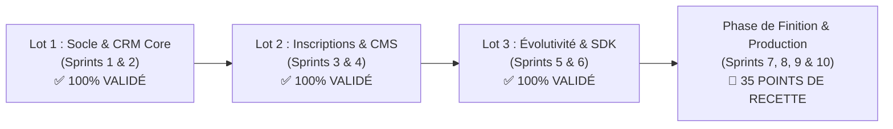
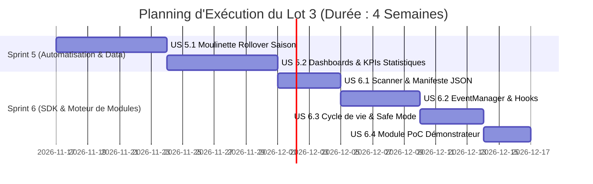

# Feuille de Route Agile & Découpage Opérationnel (ROADMAP.md)

**Projet :** Kanso-ya CMS Associatif (Core & Extensibilité)  
**Rôle :** @cp (Chef de Projet Agile / Product Owner)  
**Version :** 2.0 (Post-Recette Lot 2 — Préparation Lot 3)  
**Date :** 16 novembre 2026  

---

## 1. Synthèse Globale des Releases & État d'Avancement Réel

Le projet Kanso-ya est développé selon la méthodologie **Scrum** avec des sprints de deux semaines. La trajectoire globale est structurée en 3 phases majeures (Lots) :



### Tableau de Bord d'Avancement par Lot & Sprint

| Phase / Lot | Sprints | Objectifs Clés (35 Points de Recette) | Story Points | Statut Réel | Tests E2E |
| :--- | :---: | :--- | :---: | :---: | :---: |
| **Lot 1 : Socle & CRM** | Sprint 1 & 2 | BDD SQLite WAL, Shadow Login, 2FA, RBAC Multi-colonnes, CRM & Fiches | **44 SP** | **Terminé & Recetté** | 28/28 Pass ✅ |
| **Lot 2 : Inscriptions & CMS** | Sprint 3 & 4 | Wizard Public, Panier Familial, Trésorerie réversible, OTP, Studio CMS 2 onglets | **47 SP** | **Terminé & Recetté** | 32/32 Pass ✅ |
| **Lot 3 : Évolutivité & SDK** | Sprint 5 & 6 | Rollover de saison, Stats avancées, Scanner de modules, EventManager & Safe Mode | **34 SP** | **Terminé & Recetté** | 38/38 Pass ✅ |
| **Sprint 7 (Finition 1)** | Sprint 7 | URLs propres, Header épuré, Visiteur strict, 2FA SVG 30s, Multi-Superadmin, Backup BDD (Pts 1-6, 10, 11, 15, 29, 30, 35) | **21 SP** | **Terminé & Recetté** | 52/52 Pass ✅ |
| **Sprint 8 (Finition 2)** | Sprint 8 | Remises paramétrables (%/fixe), Mode certificat/questionnaire santé Cerfa, Brouillon localStorage (Pts 7-9, 12-14, 16-17) | **24 SP** | **Prêt à l'exécution** | Prévu (Sprint 8) |
| **Sprint 9 (Finition 3)** | Sprint 9 | Traçabilité CMS (`created_by`/`updated_by`), Reçus & Attestations CE, Exports CRM, Tris & Filtres (Pts 18-26) | **26 SP** | **Planifié** | Prévu (Sprint 9) |
| **Sprint 10 (Finition 4)** | Sprint 10 | Console Superadmin découpée, Hook SDK `stats_tabs`, Templates emails, a11y WCAG & SEO (Pts 27, 28, 31-34) | **20 SP** | **Planifié** | Prévu (Sprint 10) |
| **TOTAL GÉNÉRAL** | **10 Sprints** | **CMS & CRM Associatif Kanso-ya Production Ready (v1.2.0)** | **216 SP** | **78.7% Réalisé** | **150/150 Pass** |

---

## 2. Bilan Réel du Lot 1 (Fondations, Sécurité & CRM Core)

Le Lot 1 a posé les fondations techniques, la gestion fine des accès et l'annuaire d'adhérents.

### 2.1. Fonctionnalités Codées & Livrées (Sprints 1 & 2)

* **Architecture & Persistance :** Schéma relationnel complet (`001_core_schema.php`) en SQLite 3 WAL avec `busy_timeout = 15000` et support hybride MySQL dans `.env`.
* **Sécurité & Authentification Étanche :**
  * **Shadow Login :** URL furtive Superadmin définie dans `.env` (`/sys-admin-xyz` vers `public/sys-admin-login.php`). Rejet strict du Superadmin sur `/login` standard (401/403).
  * Table `sys_superadmins` totalement décorrélée de la table des membres `users`.
  * Hachage des mots de passe en Bcrypt/Argon2, protection brute-force (`failed_login_attempts`, `locked_until`).
* **Console Superadmin (`/sys-console.php`) :**
  * Personnalisation dynamique du thème (couleurs primaire/sidebar/header, logo du club, filigrane en fond avec opacité paramétrable).
  * Configuration et test de transmission SMTP traçable dans `email_logs` et `sys_logs`.
* **Gabarit Maître Holy Grail (`core/ui/templates/layout.php`) :**
  * Logo institutionnel à cheval Header/Sidebar (`#overlapping-logo-badge`).
  * Nom de l'association centré dynamiquement (`#club-name-heading`).
  * Tiroir mobile (Drawer) coulissant avec overlay cliquable (`#sidebar-backdrop`).
* **Matrice RBAC en Tableau Unique Multi-Colonnes (`/roles.php`) :**
  * Ajout dynamique de colonnes de rôle via formulaire UI.
  * Modification en ligne des permissions et renommage de rôles.
  * Protection absolue des rôles système verrouillés (`is_system = 1`).
* **CRM Adhérents & Paramétrage Sportif (`/members.php`, `/disciplines.php`) :**
  * Filtrage instantané des lignes du tableau DOM en TypeScript (0ms).
  * Accordéon dépliable sur clic pour afficher les tuteurs rattachés et les paramètres RGPD.
  * Upload sécurisé des certificats médicaux dans `storage/private_uploads/` avec blocage d'accès public par `.htaccess`.
  * Référentiel unifié des `levels` : distinction entre Grades (catégories d'âge U12/U14) et Niveaux (ceintures de couleur/gants) avec badges numérotés d'effectifs.
* **Espace "Mon Profil" à 2 Onglets (`/dashboard.php`) :**
  * Onglet 1 : Coordonnées et champs personnalisés dynamiques (`custom_fields`).
  * Onglet 2 : Sécurité avec activation/désactivation de la double authentification (2FA TOTP).

### 2.2. Points de Vigilance & Contrôles QA Récurrents

> [!WARNING]
> **Points de vigilance à re-vérifier à chaque cycle :**
> 1. **Fuite de privilèges Superadmin :** Vérifier qu'aucune route `/api/v1/sys/*` n'est accessible avec un cookie utilisateur standard.
> 2. **Rétention des sessions :** Confirmer la destruction du cookie côté serveur lors du `POST /api/v1/auth/logout`.
> 3. **Non-régression des filtres de sidebar :** S'assurer que les liens réservés au bureau (`/roles.php`, `/registrations.php`) restent masqués pour un profil Adhérent ou Rédacteur.

---

## 3. Bilan Réel du Lot 2 (Inscriptions, Onboarding, Trésorerie & Studio CMS)

Le Lot 2 a ouvert le CMS vers l'extérieur : tunnel d'inscription public, gestion des familles, émission d'accès OTP et publication de contenu.

### 3.1. Fonctionnalités Codées & Livrées (Sprints 3 & 4)

* **Tunnel d'Inscription Public Intelligent (`/register.php`) :**
  * **Adaptation TS de minorité :** Calcul de l'âge en temps réel ; bascule automatique vers l'étape des tuteurs légaux si âge < 18 ans.
  * **Transfert automatique de courriel :** L'adresse email saisie par un mineur est automatiquement transférée vers le champ du Responsable Légal 1.
  * **Panier Familial Multi-Adhérents :** Possibilité d'enrôler N enfants sous le même dossier avec calcul automatique de la remise fratrie (-10%) et choix du paiement (1x ou 3x par chèque/espèces/virement).
  * **Protection Anti-DoS :** Rejet systématique des paniers contenant plus de 10 adhérents.
  * **Réinscription en mode connecté :** Pré-remplissage immédiat pour les parents déjà identifiés (`tutorA`).
* **Trésorerie & Radiation Réversible (`/registrations.php`) :**
  * Validation d'inscription par le bureau (`finances.manage`) provoquant l'activation des fiches `members`, la création des comptes `users` et la traçabilité dans `app_logs`.
  * **Radiation Réversible :** Possibilité de marquer un dossier `status = 'radiated'` sans suppression physique, avec bouton de restauration immédiat ("Restaurer en attente").
  * Émission et consultation de reçus de cotisation.
* **Onboarding & Cycle de Vie OTP (`/activate-otp.php`) :**
  * Génération d'un jeton OTP valide 48h à la validation d'un membre.
  * **Usage strictement unique :** Le jeton est consommé et invalidé dès la première définition du mot de passe.
  * **Renvoi manuel par le bureau :** Bouton de renvoi d'un nouveau lien OTP 48h depuis la fiche adhérent (`/api/v1/members/:id/resend-otp`).
* **Cloisonnement & Partage RGPD Inter-Tuteurs :**
  * Cloisonnement strict par défaut : le Tuteur A ne voit pas les coordonnées personnelles du Tuteur B.
  * Mécanisme Opt-in bilatéral (`info_shared = true`) via `PATCH /api/v1/members/:id/share-tutor-info`.
* **Studio CMS à 2 Onglets (`/cms.php`) :**
  * **Onglet 1 (Builder Multi-Colonnes) :** Ajout de rangées 1, 2 ou 3 colonnes, blocs de texte et images avec prévisualisation modale en temps réel (`#article-preview-modal`).
  * **Onglet 2 (Gestion des Publications) :** Table des articles, filtres par statut et catégories Tailwind.
  * **Workflow de validation :** Forçage automatique au statut `draft` pour les utilisateurs sans droit `articles.publish`.
  * **Neutralisation XSS :** Purge des balises `<script>` et attributs malveillants (`onclick`).
  * **Étanchéité de visibilité :** Les visiteurs anonymes reçoivent une 404 (et non 403) sur les articles privés pour masquer l'existence de la ressource.
* **Pages Institutionnelles Fixes (`/legal.php`) :**
  * Routes dédiées `/rgpd` et `/cgv` avec édition de contenu en base (`pages`).

### 3.2. Points de Vigilance & Contrôles QA Récurrents

> [!WARNING]
> **Points de vigilance à re-vérifier à chaque cycle :**
> 1. **Concurrence Playwright sur SQLite :** Veiller à ce que les tests E2E s'exécutant en 6 workers parallèles utilisent `BEGIN IMMEDIATE` pour éviter les erreurs `database is locked` lors des modifications de rôles.
> 2. **Double utilisation OTP :** Tester impérativement le rejet 400 sur rejeu d'un lien OTP déjà activé.
> 3. **Visibilité 404 vs 403 :** Garantir que les visiteurs anonymes ne reçoivent jamais de 403 sur une ressource masquée (règle d'or anti-énumération).

---

## 4. Découpage Détaillé du Lot 3 : Automatisation, Rollover & Moteur de Modules SDK

Le **Lot 3** constitue l'étape finale du Core Kanso-ya. Il vise à automatiser les tâches annuelles récurrentes et à ouvrir le système aux extensions tierces (Boutique, Pointage, Gestion de tournois) sans altérer le Core.



---

### 4.1. Sprint 5 : Automatisation, Rollover & Statistiques Avancées (13 SP) — [100% TERMINÉ & VALIDÉ QA]

**Durée :** 2 Semaines  
**Objectif :** Supprimer la saisie manuelle lors du changement de saison sportive et offrir au bureau des tableaux de bord analytiques dynamiques.  
**Statut :** ✅ **100% Validé (16/16 tests passants dans `tests/e2e/06-sprint5-analytics-rollover.spec.ts`, total suite 112/112 passants)**

#### US 5.1 : Moulinette de Changement de Saison (Rollover Annuel) — ✅ VALIDÉ
* **En tant que** Président ou Superadmin
* **Je veux** déclencher en un clic le recalcul massif des catégories d'âge et le passage à la nouvelle saison sportive
* **Afin de** préparer la rentrée sans avoir à rééditer manuellement les centaines de fiches du club.
* **Story Points :** 8
* **Critères d'Acceptation (CA) :**
  * **CA1 :** L'endpoint `POST /api/v1/tasks/rollover-season` accepte la date de référence (ex: 1er janvier ou 1er septembre selon la clé `season_type` de `sys_settings`) et la nouvelle saison cible (ex: `2027-2028`).
  * **CA2 :** Le système met à jour automatiquement le `grade_id` / catégorie d'âge dans `member_practices` pour chaque membre actif.
  * **CA3 (Sécurité Métier) :** Si `is_category_forced = 1` (surclassement validé par l'entraîneur), la moulinette ignore strictement le membre et consigne une note informative.
  * **CA4 :** L'opération est exécutée dans une transaction SQLite unique et consigne une entrée détaillée dans `app_logs` (nombre d'adhérents promus, nombre de surclassés ignorés).
* **Tâches Techniques :**
  1. [x] Créer le service `core/Api/Services/RolloverService.php` avec préchargement mémoire et transaction `BEGIN IMMEDIATE` / retry backoff.
  2. [x] Implémenter la route dans `public/api.php` avec contrôle d'accès strict (Président ou Superadmin, rejet 403 pour les autres rôles).
  3. [x] Ajouter le bouton "Déclencher le basculement de saison" dans `sys-console.php` et `dashboard.php` avec modale de confirmation rouge et récapitulatif avant validation.
  4. [x] Rédiger les tests E2E Playwright `TC-ROLLOVER-01`, `TC-ROLLOVER-02`, `TC-ROLLOVER-03`, `TC-ROLLOVER-04` couvrant le cas nominal, le cas surclassé, le rejet 403 et l'UI modale.

#### US 5.2 : Tableaux de Bord Analytiques & KPIs Statistiques — ✅ VALIDÉ
* **En tant que** Membre du Bureau (Président, Trésorier, Enseignant)
* **Je veux** consulter des indicateurs visuels et graphiques sur les effectifs, la trésorerie et la répartition par niveaux
* **Afin de** piloter la politique sportive et financière de l'association.
* **Story Points :** 5
* **Critères d'Acceptation (CA) :**
  * **CA1 :** L'API expose des routes d'agrégation performantes (`GET /api/v1/stats/kpis`, `GET /api/v1/stats/demographics`).
  * **CA2 :** La page `public/stats.php` intègre des cartes statistiques réactives (taux de renouvellement, ratio hommes/femmes, effectifs par créneau).
  * **CA3 (Cloisonnement RGPD) :** Pour le profil Enseignant, les statistiques d'adhésion sont strictement anonymisées (aucun nom ni montant financier affiché).
* **Tâches Techniques :**
  1. [x] Enrichir `core/Api/Endpoints/SystemController.php` avec les requêtes SQL d'agrégation groupée (`getKpis`, `getDemographics`).
  2. [x] Implémenter `core/ui/ts/stats.ts` et mettre à jour `stats.php` avec des cartes statistiques Tailwind interactives et badge RGPD.
  3. [x] Rédiger les tests E2E `TC-STAT-01`, `TC-STAT-02`, `TC-STAT-ADVANCED` et `TC-STAT-03` validant l'étanchéité des montants financiers selon le rôle.

---

### 4.2. Sprint 6 : Moteur de Modules, SDK & Architecture Résiliente (21 SP) — [100% TERMINÉ & VALIDÉ QA]

**Durée :** 2 Semaines  
**Statut Réel :** Validé à 100% (124 tests passés sur 124, 0 erreur PHPStan, 0 erreur TS).  
**Objectif :** Implémenter l'infrastructure d'extensibilité du Core permettant l'injection de modules sans jamais modifier le code source natif, avec isolation des erreurs (Safe Mode).

#### US 6.1 : Le Scanner de Modules & Validation du `manifest.json`
* **En tant que** Superadmin
* **Je veux** que le CMS détecte automatiquement les sous-dossiers déposés dans `/modules/` et lise leur manifeste
* **Afin de** connaître les extensions installables et vérifier leur compatibilité avant activation.
* **Story Points :** 5
* **Critères d'Acceptation (CA) :**
  * **CA1 :** Création de la table `modules` via une nouvelle migration `003_modules_schema.php` :
    ```sql
    CREATE TABLE IF NOT EXISTS modules (
        id INTEGER PRIMARY KEY AUTOINCREMENT,
        folder_name VARCHAR(100) NOT NULL UNIQUE,
        name VARCHAR(150) NOT NULL,
        version VARCHAR(30) NOT NULL,
        is_active INTEGER NOT NULL DEFAULT 0,
        status VARCHAR(30) NOT NULL DEFAULT 'inactive',
        last_error TEXT NULL,
        updated_at DATETIME NOT NULL DEFAULT CURRENT_TIMESTAMP
    );
    ```
  * **CA2 :** La classe `core/Api/Services/ModuleScanner.php` parcourt `/modules/*/manifest.json`. Si un fichier est absent ou corrompu, le dossier est ignoré silencieusement avec inscription d'un avertissement dans `sys_logs`.
  * **CA3 :** Si la version courante du Core n'est pas comprise dans l'intervalle `[core_min_version, core_max_version]`, l'UI affiche le module avec le statut "Incompatible" et le bouton d'activation est désactivé.
* **Tâches Techniques :**
  1. Créer la migration `core/Api/Database/migrations/003_modules_schema.php`.
  2. Développer `ModuleScanner.php`.
  3. Exposer les routes `GET /api/v1/sys/modules` et `POST /api/v1/sys/modules/scan`.
  4. Intégrer la liste des modules dans l'interface de la console système `sys-console.php`.

#### US 6.2 : L'EventManager & Système de Hooks (Actions & Filtres)
* **En tant qu'** Architecte Logiciel
* **Je veux** un répartiteur d'événements central capable d'émettre des Actions et d'appliquer des Filtres
* **Afin que** les modules puissent étendre les comportements et les interfaces sans altérer le Core.
* **Story Points :** 8
* **Critères d'Acceptation (CA) :**
  * **CA1 :** Création du Singleton `Core\Api\Services\EventManager` avec les méthodes :
    * `listen(string $actionName, callable $callback, int $priority = 10): void`
    * `dispatch(string $actionName, array $payload = []): void`
    * `addFilter(string $filterName, callable $callback, int $priority = 10): void`
    * `applyFilters(string $filterName, mixed $value, array $context = []): mixed`
  * **CA2 (Points d'accroche UI) :** Le gabarit [`layout.php`](file:///c:/laragon/www/kanso-ya/core/ui/templates/layout.php) applique le filtre `applyFilters('admin_sidebar_menu', $menuItems)` pour permettre aux modules actifs d'insérer leurs liens de navigation.
  * **CA3 (Points d'accroche Métier) :** Le Core émet des événements système :
    * `on_member_created`, `on_member_deleted`
    * `on_registration_validated`
    * `on_article_published`
* **Tâches Techniques :**
  1. Créer `core/Api/Services/EventManager.php`.
  2. Brancher les filtres de menu dans `core/ui/templates/layout.php`.
  3. Insérer les déclencheurs `dispatch()` dans `MemberController.php`, `RegistrationController.php` et `CmsController.php`.

#### US 6.3 : Cycle de Vie, Persistance SQL & "Safe Mode" Résilient
* **En tant que** Superadmin
* **Je veux** que l'activation/désactivation d'un module exécute ses scripts de cycle de vie et qu'un crash de module ne rende jamais le site indisponible
* **Afin de** garantir la haute disponibilité et la robustesse de l'association.
* **Story Points :** 8
* **Critères d'Acceptation (CA) :**
  * **CA1 :** Définition de l'interface `core/Api/Services/ModuleInterface.php` imposant `install()`, `uninstall()`, `boot(EventManager $em)`.
  * **CA2 (Préfixage Strict) :** Toute table créée lors de `install()` doit obligatoirement respecter la convention `mod_<identifiant>_*`.
  * **CA3 (Safe Mode Automatique) :** L'amorçage (`boot()`) de chaque module est encapsulé dans un `try/catch`. En cas de `Throwable` levée par un module :
    1. L'exception est interceptée sans interrompre la requête utilisateur ;
    2. Le statut du module dans la table `modules` bascule immédiatement à `status = 'crashed'` et `is_active = 0` ;
    3. La trace de l'erreur est consignée dans `modules.last_error` et `sys_logs` ;
    4. Une alerte visuelle rouge s'affiche sur la console Superadmin.
* **Tâches Techniques :**
  1. Écrire `core/Api/Services/ModuleInterface.php` et le chargeur dynamique `ModuleManager.php`.
  2. Implémenter les routes d'administration `PATCH /api/v1/sys/modules/:id/toggle` et `POST /api/v1/sys/modules/:id/uninstall`.
  3. Intégrer le mécanisme de Safe Mode dans le bootstrap applicatif.

#### US 6.4 (PoC Démonstrateur) : Module Exemple "Boutique Club"
* **En tant que** Développeur Tiers
* **Je veux** disposer d'un module exemple fonctionnel validant l'ensemble du SDK
* **Afin de** servir de référence d'implémentation pour les futurs modules.
* **Story Points :** 3
* **Critères d'Acceptation (CA) :**
  * **CA1 :** Création du dossier `modules/Boutique/` avec `manifest.json`, `Module.php`, et vue dédiée.
  * **CA2 :** L'activation crée la table `mod_boutique_products` et injecte le lien "Boutique" dans la sidebar.
  * **CA3 :** La désactivation retire le lien du menu et la désinstallation purge la table.
* **Tâches Techniques :**
  1. Créer le squelette de module `modules/Boutique/`.
  2. Écrire la suite de tests Playwright E2E `TC-MODULES-SDK.spec.ts` validant le scan, l'activation, l'injection de menu, et le déclenchement du Safe Mode sur simulation de crash.

---

## 5. Gouvernance, Critères DoD (Definition of Done) & Jalons

### 5.1. Definition of Done (DoD) pour le Lot 3

Pour qu'une User Story du Lot 3 soit déclarée **DONE** :
1. **Architecture & Standards :**
   * Code PHP typé strictement (`declare(strict_types=1)`), analysé sans erreur critique par PHPStan.
   * Réponses API systématiquement encapsulées dans l'enveloppe JSend avec code réseau HTTP 200 invariable.
2. **Concurrence & Données :**
   * Toutes les écritures SQL en base utilisent `BEGIN IMMEDIATE` et respectent le verrouillage SQLite en mode WAL.
   * Tables de modules préfixées obligatoirement par `mod_*`.
3. **Qualité & Tests :**
   * Suite Playwright exécutée et validée à 100% sur Desktop et Mobile Chrome (`npm run test:e2e`).
   * Aucun rapport d'échec généré dans `error-reports/`.
   * Compilation TypeScript sans avertissement (`npm run build:ts`).
   * Compilation des styles sans régression (`npm run build:css`).

### 5.2. Commandes de Validation Opérationnelle

```powershell
# 1. Compilation des sources TypeScript
npm run build:ts

# 2. Compilation des styles Tailwind CSS
npm run build:css

# 3. Réinitialisation des fixtures BDD de test
npm run db:reset

# 4. Exécution intégrale de la suite E2E Playwright
npm run test:e2e
```

### 5.3. Calendrier Prévisionnel de Clôture

* **Lancement Sprint 5 :** 17 novembre 2026
* **Revue & Recette Sprint 5 :** 30 novembre 2026
* **Lancement Sprint 6 :** 01 décembre 2026
* **Revue & Recette Finale Core v1.0.0 (Lot 3) :** 15 décembre 2026
* **Sprint 7 (Socle, Navigation, Auth, Thème & Backup BDD) :** ✅ **100% VALIDÉ (150/150 Pass)**
* **Sprint 8 (Inscriptions Avancées, Remises & Santé) :** ✅ **100% VALIDÉ (162/162 Pass, commit ecfebe2)**
* **Sprint 9 (CRM, Studio CMS Traçable, Exports & Reçus) :** ✅ **100% VALIDÉ (176/176 Pass, commit 4340bec)**
* **Sprint 10 (Console Découpée, SDK, RBAC Sticky & Horaires) :** ✅ **100% VALIDÉ (188/188 Pass, commit c599fd2)**
* **Sprint 11 (Lockdown Final Massif E2E & UAT) :** ✅ **100% VALIDÉ (208/208 Pass - Release v1.0.0-final)**

---

## 6. Phase de Finition & Clôture Production (Sprints 7 à 11) — Les 35 Points de Recette

La phase de finition intègre les **35 retours de recette manuelle** répartis rigoureusement en 5 jalons opérationnels, désormais **100 % Achevés et Homologués** :

```mermaid
flowchart TD
    subgraph S7["Sprint 7 : Socle, Auth & Navigation (Points 1-6, 10, 11, 15, 29, 30, 35) ✅ VALIDÉ"]
        P1["Points 1 & 2 : Header épuré & Visiteur strict"]
        P2["Point 3 : Backup/Restore SQLite Playwright"]
        P3["Point 4 : URLs propres sans .php"]
        P4["Points 5 & 6 : Login refondu & Redirection post-connexion /"]
        P5["Points 10, 11, 15 & 35 : 2FA SVG 30s, Toggle Secret, Règles MDP & Multi-Superadmin"]
        P6["Points 29 & 30 : Thème dynamique CSS --brand-primary / --brand-accent"]
    end

    subgraph S8["Sprint 8 : Inscriptions Avancées, Remises & Santé (Points 7-9, 12-14, 16-17) ✅ VALIDÉ"]
        P7["Points 7 & 8 : Remises de cotisation paramétrables (% ou montant fixe) & calcul panier"]
        P8["Points 9, 12 & 13 : Mode certificat vs Questionnaire santé (/questionnaire-sante) & RGPD santé"]
        P9["Point 14 : Contacts d'urgence enrichis (téléphone secondaire, lien parenté)"]
        P10["Points 16 & 17 : Brouillon localStorage & Modale récapitulative pré-soumission"]
    end

    subgraph S9["Sprint 9 : CRM, Studio CMS Traçable, Exports & Reçus (Points 18-26) ✅ VALIDÉ"]
        P11["Points 18 & 19 : Traçabilité auteur/éditeur (created_by, updated_by) sur articles CMS"]
        P12["Point 20 : Reçus de cotisation & Attestations CE/CSE téléchargeables"]
        P13["Point 21 : Export CSV/Excel filtré des adhérents selon permissions"]
        P14["Points 22 & 23 : Filtres avancés CRM (tranches d'âge, mode paiement) & Historique saisons"]
        P15["Points 24-26 : Actions groupées CRM, gestion des médias CMS & Tri multi-colonnes trésorerie"]
    end

    subgraph S10["Sprint 10 : Console Découpée, SDK & Horaires Dynamiques (Points 27, 28, 31-34) ✅ VALIDÉ"]
        P16["Point 27 : Console Superadmin découpée (/sys-branding, /sys-smtp, /sys-modules, /sys-logs)"]
        P17["Point 28 : Matrice RBAC sticky avec toggles & hook EventManager stats_tabs"]
        P18["Points 31 & 32 : Templates d'e-mails transactionnels personnalisables & page dynamique /horaires"]
        P19["Points 33 & 34 : Accessibilité WCAG AA, Modales Escape, SEO OpenGraph, Favicon"]
    end

    subgraph S11["Sprint 11 : Lockdown Final Massif E2E & Homologation Générale ✅ VALIDÉ"]
        P20["Lockdown 12 Suites E2E : Étanchéité absolue des 8 rôles, Sécurité, Concurrence & Grand Chelem UAT"]
    end

    S7 --> S8 --> S9 --> S10 --> S11
```



---

### 6.1. Sprint 7 (Achevé & Validé) : Socle, Navigation, Auth, Thème & Backup BDD
* **Story Points :** 21 SP | **Statut :** ✅ **100% VALIDÉ EN RECETTE (150/150 Pass)**

---

### 6.2. Sprint 8 (Achevé & Validé) : Inscriptions Avancées, Remises Paramétrables & Santé
* **Story Points :** 24 SP | **Statut :** ✅ **100% VALIDÉ EN RECETTE (162/162 Pass, commit ecfebe2)**
* **Points de Recette Couverts :**
  - **Point 7 :** Paramétrage des remises de cotisation dans `sys_settings` : seuil d'adhérents déclencheur (`discount_threshold`), type de remise (`discount_type` : `'percent'` ou `'fixed'`), valeur de la remise (`discount_value`).
  - **Point 8 :** Calcul dynamique de la remise dans le tunnel d'inscription public (`register.ts`) avec affichage transparent de la ligne de déduction dans le récapitulatif du panier.
  - **Point 9 :** Paramétrage dans `sys_settings` de l'option médicale (`medical_cert_mode` : `'mandatory'`, `'optional'`, `'health_questionnaire'`).
  - **Point 12 :** Création de la page publique dédiée [`/questionnaire-sante`](file:///c:/laragon/www/kanso-ya/public/health-check.php) intégrant l'auto-évaluation Cerfa réglementaire (questions différenciées mineurs / majeurs).
  - **Point 13 :** Cloisonnement RGPD santé : le CMS ne persiste aucune réponse médicale individuelle, seule l'attestation sur l'honneur positive ("Toutes les réponses sont NON") est enregistrée sous forme de drapeau booléen daté.
  - **Point 14 :** Contact d'urgence enrichi dans le formulaire d'inscription (numéro secondaire alternatif, lien de parenté explicite).
  - **Point 16 :** Sauvegarde temps réel du brouillon d'inscription dans le LocalStorage du navigateur (reprise sur rechargement de page accidentel).
  - **Point 17 :** Écran de pré-soumission avec modale de confirmation des engagements tarifaires et des consentements légaux.

---

### 6.3. Sprint 9 (Achevé & Validé) : CRM, Studio CMS Traçable, Exports & Reçus
* **Story Points :** 26 SP | **Statut :** ✅ **100% VALIDÉ EN RECETTE (176/176 Pass, commit 4340bec)**
* **Points de Recette Couverts :**
  - **Point 18 :** Traçabilité éditoriale dans la table `articles` : colonnes `created_by` (auteur initial) et `updated_by` (dernier modificateur/publieur) associées à `created_at` et `updated_at`.
  - **Point 19 :** Affichage dans la liste des publications du Studio CMS du créateur de l'article et du dernier éditeur/relecteur.
  - **Point 20 :** Module de génération et téléchargement de reçus d'adhésion et d'attestations CE/CSE certifiés conformes pour les dossiers validés.
  - **Point 21 :** Export CSV UTF-8 avec BOM `\uFEFF` des effectifs CRM avec filtrage automatique selon les autorisations du rôle connecté (anonymisation stricte pour l'Entraîneur).
  - **Point 22 :** Filtres combinés avancés sur l'annuaire CRM (filtrage par tranche d'âge, statut d'attestation médicale, mode de paiement).
  - **Point 23 :** Historique des cotisations et saisons précédentes affiché sur la fiche détaillée de l'adhérent.
  - **Point 24 :** Barre d'actions groupées sur le CRM (sélection multiple pour relance OTP groupée `#btn-bulk-resend-otp`).
  - **Point 25 :** Nettoyeur de médiathèque CMS (détection et suppression sécurisée des images orphelines non référencées `#btn-cleanup-orphans`).
  - **Point 26 :** Tri multi-colonnes interactif et persistant sur le tableau des cotisations et dossiers financiers.

---

### 6.4. Sprint 10 (Achevé & Validé) : Console Superadmin Découpée, Extensibilité SDK & Clôture Production
* **Story Points :** 20 SP | **Statut :** ✅ **100% VALIDÉ EN RECETTE (188/188 Pass, commit c599fd2)**
* **Points de Recette Couverts :**
  - **Point 27 :** Découpage de la console Superadmin en sous-routes dédiées pour une ergonomie optimale :
    - `/sys-branding` : Logo, filigrane, couleurs multi-zones et préréglages instantanés.
    - `/sys-smtp` : Configuration du serveur mail, tests d'envoi et éditeur de templates transactionnels (`email_templates`).
    - `/sys-modules` : Gestionnaire de modules SDK et alertes Safe Mode.
    - `/sys-logs` : Journaux d'audit système et logs de messagerie.
  - **Point 28 :** Matrice RBAC `/roles` à colonne gauche figée `sticky left-0 bg-white z-10 shadow-xs` et toggles switchs interactifs.
  - **Point 31 :** Gestionnaire de templates d'e-mails transactionnels (Invitation OTP, Accusé de réception, Validation) avec balises dynamiques.
  - **Point 32 :** Page dynamique institutionnelle [`/horaires`](file:///c:/laragon/www/kanso-ya/public/horaires.php) avec grille responsive des cours, catégories d'âge et tarifs annuels.
  - **Point 33 :** Accessibilité modale renforcée (`role="dialog"`, `aria-modal="true"`) et fermeture globale par la touche `Escape`.
  - **Point 34 :** Pack de mise en production : Favicon dynamique synchronisé avec le logo club, balises OpenGraph (`og:title`, `og:description`), meta description SEO.

---

### 6.5. Sprint 11 (Achevé & Validé) : Lockdown Final Massif E2E & Homologation Générale
* **Story Points :** 16 SP | **Statut :** ✅ **100% VALIDÉ EN RECETTE (208/208 Pass - Release v1.0.0-final)**
* **Objectif :** Épreuve du feu finale et verrouillage global par les tests Playwright Desktop & Mobile :
  - Étanchéité absolue des 8 rôles (`Visiteur`, `Adhérent`, `Entraîneur`, `Rédacteur`, `Trésorier`, `Secrétaire`, `Président`, `Superadmin`).
  - Validation des rejets 401/403 et de la résilience aux injections / fraudes OTP.
  - Exécution sans accroc du Grand Chelem UAT interconnecté.


