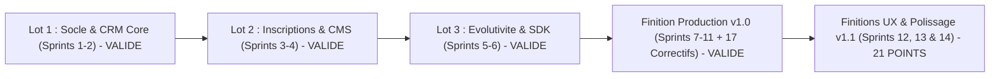
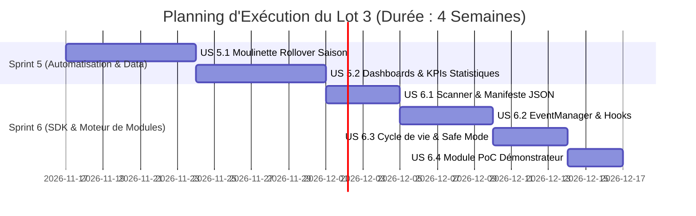

# Feuille de Route Agile & Découpage Opérationnel (ROADMAP.md)

**Projet :** Kanso-ya CMS Associatif (Core & Extensibilité)  
**Rôle :** @cp (Chef de Projet Agile / Product Owner)  
**Version :** 2.2 (Post-Correctifs v1.0 — Planification Finitions UX & Polissage v1.1)  
**Date :** 18 novembre 2026  

---

## 1. Synthèse Globale des Releases & État d'Avancement Réel

Le projet Kanso-ya est développé selon la méthodologie **Scrum** avec des sprints de deux semaines. La trajectoire globale est structurée en phases successives jusqu'à la v1.1 :



### Tableau de Bord d'Avancement par Lot & Sprint

| Phase / Lot | Sprints | Objectifs Clés | Story Points | Statut Réel | Tests E2E |
| :--- | :---: | :--- | :---: | :---: | :---: |
| **Lot 1 : Socle & CRM** | Sprint 1 & 2 | BDD SQLite WAL, Shadow Login, 2FA, RBAC Multi-colonnes, CRM & Fiches | **44 SP** | **Terminé & Recetté** | 28/28 Pass ✅ |
| **Lot 2 : Inscriptions & CMS** | Sprint 3 & 4 | Wizard Public, Panier Familial, Trésorerie réversible, OTP, Studio CMS 2 onglets | **47 SP** | **Terminé & Recetté** | 32/32 Pass ✅ |
| **Lot 3 : Évolutivité & SDK** | Sprint 5 & 6 | Rollover de saison, Stats avancées, Scanner de modules, EventManager & Safe Mode | **34 SP** | **Terminé & Recetté** | 38/38 Pass ✅ |
| **Finition v1.0 (35 Pts)** | Sprints 7 à 11 | URLs propres, Remises, Cerfa santé, Exports/Reçus, Console découpée & Lockdown E2E | **107 SP** | **Terminé & Recetté** | 208/208 Pass ✅ |
| **Correctifs Post-Recette (17 Pts)** | Blocs 1 à 3 | Isolation Superadmin, Profil/Club séparés, Studio CMS Drag & Drop, Vidéo & Carrousels | **26 SP** | **Terminé & Recetté** | 222/222 Pass ✅ |
| **Sprint 12 (Polissage v1.1 - 1/3)** | Sprint 12 | Langage humain global, Toasts validation, Thème CSS `--brand-*`, Rollover alias & Mode Démo/Prod (Pts 1-7) | **18 SP** | **Terminé & Recetté** | 230/230 Pass ✅ |
| **Sprint 13 (Polissage v1.1 - 2/3)** | Sprint 13 | Mot de passe oublié OTP + double saisie, 2FA multi-méthode (QR/Clé/Email), Inscription vierge/`?discipline=ID`, Réinscription complète & Aperçu texte confirmation (Pts 8-14) | **21 SP** | **Terminé & Recetté** | 238/238 Pass ✅ |
| **Sprint 14 (Polissage v1.1 - 3/3)** | Sprint 14 | Tableaux compacts sans débordement, Actions sur 2 lignes (`/members`, `/registrations`), Onglets `/stats`, `/sys-smtp` & multi-disciplines + Lockdown v1.1 (Pts 15-21) | **19 SP** | **Planifié** | Prévu (Sprint 14) |
| **TOTAL GÉNÉRAL** | **14 Sprints** | **CMS & CRM Associatif Kanso-ya v1.1** | **316 SP** | **81.6% Réalisé** | **222/222 Pass** |

---

## 2. Bilan Réel du Lot 1 (Fondations, Sécurité & CRM Core)

Le Lot 1 a posé les fondations techniques, la gestion fine des accès et l'annuaire d'adhérents.

### 2.1. Fonctionnalités Codées & Livrées (Sprints 1 & 2)

* **Architecture & Persistance :** Schéma relationnel complet (`001_core_schema.php`) en SQLite 3 WAL avec `busy_timeout = 15000` et support hybride MySQL dans `.env`.
* **Sécurité & Authentification Étanche :**
  * **Shadow Login :** URL furtive Superadmin définie dans `.env` (`/sys-admin-xyz` vers `public/sys-admin-login.php`). Rejet strict du Superadmin sur `/login` standard (401/403).
  * Table `sys_superadmins` totalement décorrélée de la table des membres `users`.
  * Hachage des mots de passe en Bcrypt/Argon2, protection brute-force (`failed_login_attempts`, `locked_until`).
* **Console Superadmin (`/sys-console.php`) :**
  * Personnalisation dynamique du thème (couleurs primaire/sidebar/header, logo du club, filigrane en fond avec opacité paramétrable).
  * Configuration et test de transmission SMTP traçable dans `email_logs` et `sys_logs`.
* **Gabarit Maître Holy Grail (`core/ui/templates/layout.php`) :**
  * Logo institutionnel à cheval Header/Sidebar (`#overlapping-logo-badge`).
  * Nom de l'association centré dynamiquement (`#club-name-heading`).
  * Tiroir mobile (Drawer) coulissant avec overlay cliquable (`#sidebar-backdrop`).
* **Matrice RBAC en Tableau Unique Multi-Colonnes (`/roles.php`) :**
  * Ajout dynamique de colonnes de rôle via formulaire UI.
  * Modification en ligne des permissions et renommage de rôles.
  * Protection absolue des rôles système verrouillés (`is_system = 1`).
* **CRM Adhérents & Paramétrage Sportif (`/members.php`, `/disciplines.php`) :**
  * Filtrage instantané des lignes du tableau DOM en TypeScript (0ms).
  * Accordéon dépliable sur clic pour afficher les tuteurs rattachés et les paramètres RGPD.
  * Upload sécurisé des certificats médicaux dans `storage/private_uploads/` avec blocage d'accès public par `.htaccess`.
  * Référentiel unifié des `levels` : distinction entre Grades (catégories d'âge U12/U14) et Niveaux (ceintures de couleur/gants) avec badges numérotés d'effectifs.
* **Espace "Mon Profil" à 2 Onglets (`/dashboard.php`) :**
  * Onglet 1 : Coordonnées et champs personnalisés dynamiques (`custom_fields`).
  * Onglet 2 : Sécurité avec activation/désactivation de la double authentification (2FA TOTP).

### 2.2. Points de Vigilance & Contrôles QA Récurrents

> [!WARNING]
> **Points de vigilance à re-vérifier à chaque cycle :**
> 1. **Fuite de privilèges Superadmin :** Vérifier qu'aucune route `/api/v1/sys/*` n'est accessible avec un cookie utilisateur standard.
> 2. **Rétention des sessions :** Confirmer la destruction du cookie côté serveur lors du `POST /api/v1/auth/logout`.
> 3. **Non-régression des filtres de sidebar :** S'assurer que les liens réservés au bureau (`/roles.php`, `/registrations.php`) restent masqués pour un profil Adhérent ou Rédacteur.

---

## 3. Bilan Réel du Lot 2 (Inscriptions, Onboarding, Trésorerie & Studio CMS)

Le Lot 2 a ouvert le CMS vers l'extérieur : tunnel d'inscription public, gestion des familles, émission d'accès OTP et publication de contenu.

### 3.1. Fonctionnalités Codées & Livrées (Sprints 3 & 4)

* **Tunnel d'Inscription Public Intelligent (`/register.php`) :**
  * **Adaptation TS de minorité :** Calcul de l'âge en temps réel ; bascule automatique vers l'étape des tuteurs légaux si âge < 18 ans.
  * **Transfert automatique de courriel :** L'adresse email saisie par un mineur est automatiquement transférée vers le champ du Responsable Légal 1.
  * **Panier Familial Multi-Adhérents :** Possibilité d'enrôler N enfants sous le même dossier avec calcul automatique de la remise fratrie (-10%) et choix du paiement (1x ou 3x par chèque/espèces/virement).
  * **Protection Anti-DoS :** Rejet systématique des paniers contenant plus de 10 adhérents.
  * **Réinscription en mode connecté :** Pré-remplissage immédiat pour les parents déjà identifiés (`tutorA`).
* **Trésorerie & Radiation Réversible (`/registrations.php`) :**
  * Validation d'inscription par le bureau (`finances.manage`) provoquant l'activation des fiches `members`, la création des comptes `users` et la traçabilité dans `app_logs`.
  * **Radiation Réversible :** Possibilité de marquer un dossier `status = 'radiated'` sans suppression physique, avec bouton de restauration immédiat ("Restaurer en attente").
  * Émission et consultation de reçus de cotisation.
* **Onboarding & Cycle de Vie OTP (`/activate-otp.php`) :**
  * Génération d'un jeton OTP valide 48h à la validation d'un membre.
  * **Usage strictement unique :** Le jeton est consommé et invalidé dès la première définition du mot de passe.
  * **Renvoi manuel par le bureau :** Bouton de renvoi d'un nouveau lien OTP 48h depuis la fiche adhérent (`/api/v1/members/:id/resend-otp`).
* **Cloisonnement & Partage RGPD Inter-Tuteurs :**
  * Cloisonnement strict par défaut : le Tuteur A ne voit pas les coordonnées personnelles du Tuteur B.
  * Mécanisme Opt-in bilatéral (`info_shared = true`) via `PATCH /api/v1/members/:id/share-tutor-info`.
* **Studio CMS à 2 Onglets (`/cms.php`) :**
  * **Onglet 1 (Builder Multi-Colonnes) :** Ajout de rangées 1, 2 ou 3 colonnes, blocs de texte et images avec prévisualisation modale en temps réel (`#article-preview-modal`).
  * **Onglet 2 (Gestion des Publications) :** Table des articles, filtres par statut et catégories Tailwind.
  * **Workflow de validation :** Forçage automatique au statut `draft` pour les utilisateurs sans droit `articles.publish`.
  * **Neutralisation XSS :** Purge des balises `<script>` et attributs malveillants (`onclick`).
  * **Étanchéité de visibilité :** Les visiteurs anonymes reçoivent une 404 (et non 403) sur les articles privés pour masquer l'existence de la ressource.
* **Pages Institutionnelles Fixes (`/legal.php`) :**
  * Routes dédiées `/rgpd` et `/cgv` avec édition de contenu en base (`pages`).

### 3.2. Points de Vigilance & Contrôles QA Récurrents

> [!WARNING]
> **Points de vigilance à re-vérifier à chaque cycle :**
> 1. **Concurrence Playwright sur SQLite :** Veiller à ce que les tests E2E s'exécutant en 6 workers parallèles utilisent `BEGIN IMMEDIATE` pour éviter les erreurs `database is locked` lors des modifications de rôles.
> 2. **Double utilisation OTP :** Tester impérativement le rejet 400 sur rejeu d'un lien OTP déjà activé.
> 3. **Visibilité 404 vs 403 :** Garantir que les visiteurs anonymes ne reçoivent jamais de 403 sur une ressource masquée (règle d'or anti-énumération).

---

## 4. Découpage Détaillé du Lot 3 : Automatisation, Rollover & Moteur de Modules SDK

Le **Lot 3** constitue l'étape finale du Core Kanso-ya. Il vise à automatiser les tâches annuelles récurrentes et à ouvrir le système aux extensions tierces (Boutique, Pointage, Gestion de tournois) sans altérer le Core.



---

### 4.1. Sprint 5 : Automatisation, Rollover & Statistiques Avancées (13 SP) — [100% TERMINÉ & VALIDÉ QA]

**Durée :** 2 Semaines  
**Objectif :** Supprimer la saisie manuelle lors du changement de saison sportive et offrir au bureau des tableaux de bord analytiques dynamiques.  
**Statut :** ✅ **100% Validé (16/16 tests passants dans `tests/e2e/06-sprint5-analytics-rollover.spec.ts`, total suite 112/112 passants)**

#### US 5.1 : Moulinette de Changement de Saison (Rollover Annuel) — ✅ VALIDÉ
* **En tant que** Président ou Superadmin
* **Je veux** déclencher en un clic le recalcul massif des catégories d'âge et le passage à la nouvelle saison sportive
* **Afin de** préparer la rentrée sans avoir à rééditer manuellement les centaines de fiches du club.
* **Story Points :** 8
* **Critères d'Acceptation (CA) :**
  * **CA1 :** L'endpoint `POST /api/v1/tasks/rollover-season` accepte la date de référence (ex: 1er janvier ou 1er septembre selon la clé `season_type` de `sys_settings`) et la nouvelle saison cible (ex: `2027-2028`).
  * **CA2 :** Le système met à jour automatiquement le `grade_id` / catégorie d'âge dans `member_practices` pour chaque membre actif.
  * **CA3 (Sécurité Métier) :** Si `is_category_forced = 1` (surclassement validé par l'entraîneur), la moulinette ignore strictement le membre et consigne une note informative.
  * **CA4 :** L'opération est exécutée dans une transaction SQLite unique et consigne une entrée détaillée dans `app_logs` (nombre d'adhérents promus, nombre de surclassés ignorés).
* **Tâches Techniques :**
  1. [x] Créer le service `core/Api/Services/RolloverService.php` avec préchargement mémoire et transaction `BEGIN IMMEDIATE` / retry backoff.
  2. [x] Implémenter la route dans `public/api.php` avec contrôle d'accès strict (Président ou Superadmin, rejet 403 pour les autres rôles).
  3. [x] Ajouter le bouton "Déclencher le basculement de saison" dans `sys-console.php` et `dashboard.php` avec modale de confirmation rouge et récapitulatif avant validation.
  4. [x] Rédiger les tests E2E Playwright `TC-ROLLOVER-01`, `TC-ROLLOVER-02`, `TC-ROLLOVER-03`, `TC-ROLLOVER-04` couvrant le cas nominal, le cas surclassé, le rejet 403 et l'UI modale.

#### US 5.2 : Tableaux de Bord Analytiques & KPIs Statistiques — ✅ VALIDÉ
* **En tant que** Membre du Bureau (Président, Trésorier, Enseignant)
* **Je veux** consulter des indicateurs visuels et graphiques sur les effectifs, la trésorerie et la répartition par niveaux
* **Afin de** piloter la politique sportive et financière de l'association.
* **Story Points :** 5
* **Critères d'Acceptation (CA) :**
  * **CA1 :** L'API expose des routes d'agrégation performantes (`GET /api/v1/stats/kpis`, `GET /api/v1/stats/demographics`).
  * **CA2 :** La page `public/stats.php` intègre des cartes statistiques réactives (taux de renouvellement, ratio hommes/femmes, effectifs par créneau).
  * **CA3 (Cloisonnement RGPD) :** Pour le profil Enseignant, les statistiques d'adhésion sont strictement anonymisées (aucun nom ni montant financier affiché).
* **Tâches Techniques :**
  1. [x] Enrichir `core/Api/Endpoints/SystemController.php` avec les requêtes SQL d'agrégation groupée (`getKpis`, `getDemographics`).
  2. [x] Implémenter `core/ui/ts/stats.ts` et mettre à jour `stats.php` avec des cartes statistiques Tailwind interactives et badge RGPD.
  3. [x] Rédiger les tests E2E `TC-STAT-01`, `TC-STAT-02`, `TC-STAT-ADVANCED` et `TC-STAT-03` validant l'étanchéité des montants financiers selon le rôle.

---

### 4.2. Sprint 6 : Moteur de Modules, SDK & Architecture Résiliente (21 SP) — [100% TERMINÉ & VALIDÉ QA]

**Durée :** 2 Semaines  
**Statut Réel :** Validé à 100% (124 tests passés sur 124, 0 erreur PHPStan, 0 erreur TS).  
**Objectif :** Implémenter l'infrastructure d'extensibilité du Core permettant l'injection de modules sans jamais modifier le code source natif, avec isolation des erreurs (Safe Mode).

#### US 6.1 : Le Scanner de Modules & Validation du `manifest.json`
* **En tant que** Superadmin
* **Je veux** que le CMS détecte automatiquement les sous-dossiers déposés dans `/modules/` et lise leur manifeste
* **Afin de** connaître les extensions installables et vérifier leur compatibilité avant activation.
* **Story Points :** 5
* **Critères d'Acceptation (CA) :**
  * **CA1 :** Création de la table `modules` via une nouvelle migration `003_modules_schema.php` :
    ```sql
    CREATE TABLE IF NOT EXISTS modules (
        id INTEGER PRIMARY KEY AUTOINCREMENT,
        folder_name VARCHAR(100) NOT NULL UNIQUE,
        name VARCHAR(150) NOT NULL,
        version VARCHAR(30) NOT NULL,
        is_active INTEGER NOT NULL DEFAULT 0,
        status VARCHAR(30) NOT NULL DEFAULT 'inactive',
        last_error TEXT NULL,
        updated_at DATETIME NOT NULL DEFAULT CURRENT_TIMESTAMP
    );
    ```
  * **CA2 :** La classe `core/Api/Services/ModuleScanner.php` parcourt `/modules/*/manifest.json`. Si un fichier est absent ou corrompu, le dossier est ignoré silencieusement avec inscription d'un avertissement dans `sys_logs`.
  * **CA3 :** Si la version courante du Core n'est pas comprise dans l'intervalle `[core_min_version, core_max_version]`, l'UI affiche le module avec le statut "Incompatible" et le bouton d'activation est désactivé.
* **Tâches Techniques :**
  1. Créer la migration `core/Api/Database/migrations/003_modules_schema.php`.
  2. Développer `ModuleScanner.php`.
  3. Exposer les routes `GET /api/v1/sys/modules` et `POST /api/v1/sys/modules/scan`.
  4. Intégrer la liste des modules dans l'interface de la console système `sys-console.php`.

#### US 6.2 : L'EventManager & Système de Hooks (Actions & Filtres)
* **En tant qu'** Architecte Logiciel
* **Je veux** un répartiteur d'événements central capable d'émettre des Actions et d'appliquer des Filtres
* **Afin que** les modules puissent étendre les comportements et les interfaces sans altérer le Core.
* **Story Points :** 8
* **Critères d'Acceptation (CA) :**
  * **CA1 :** Création du Singleton `Core\Api\Services\EventManager` avec les méthodes :
    * `listen(string $actionName, callable $callback, int $priority = 10): void`
    * `dispatch(string $actionName, array $payload = []): void`
    * `addFilter(string $filterName, callable $callback, int $priority = 10): void`
    * `applyFilters(string $filterName, mixed $value, array $context = []): mixed`
  * **CA2 (Points d'accroche UI) :** Le gabarit [`layout.php`](file:///c:/laragon/www/kanso-ya/core/ui/templates/layout.php) applique le filtre `applyFilters('admin_sidebar_menu', $menuItems)` pour permettre aux modules actifs d'insérer leurs liens de navigation.
  * **CA3 (Points d'accroche Métier) :** Le Core émet des événements système :
    * `on_member_created`, `on_member_deleted`
    * `on_registration_validated`
    * `on_article_published`
* **Tâches Techniques :**
  1. Créer `core/Api/Services/EventManager.php`.
  2. Brancher les filtres de menu dans `core/ui/templates/layout.php`.
  3. Insérer les déclencheurs `dispatch()` dans `MemberController.php`, `RegistrationController.php` et `CmsController.php`.

#### US 6.3 : Cycle de Vie, Persistance SQL & "Safe Mode" Résilient
* **En tant que** Superadmin
* **Je veux** que l'activation/désactivation d'un module exécute ses scripts de cycle de vie et qu'un crash de module ne rende jamais le site indisponible
* **Afin de** garantir la haute disponibilité et la robustesse de l'association.
* **Story Points :** 8
* **Critères d'Acceptation (CA) :**
  * **CA1 :** Définition de l'interface `core/Api/Services/ModuleInterface.php` imposant `install()`, `uninstall()`, `boot(EventManager $em)`.
  * **CA2 (Préfixage Strict) :** Toute table créée lors de `install()` doit obligatoirement respecter la convention `mod_<identifiant>_*`.
  * **CA3 (Safe Mode Automatique) :** L'amorçage (`boot()`) de chaque module est encapsulé dans un `try/catch`. En cas de `Throwable` levée par un module :
    1. L'exception est interceptée sans interrompre la requête utilisateur ;
    2. Le statut du module dans la table `modules` bascule immédiatement à `status = 'crashed'` et `is_active = 0` ;
    3. La trace de l'erreur est consignée dans `modules.last_error` et `sys_logs` ;
    4. Une alerte visuelle rouge s'affiche sur la console Superadmin.
* **Tâches Techniques :**
  1. Écrire `core/Api/Services/ModuleInterface.php` et le chargeur dynamique `ModuleManager.php`.
  2. Implémenter les routes d'administration `PATCH /api/v1/sys/modules/:id/toggle` et `POST /api/v1/sys/modules/:id/uninstall`.
  3. Intégrer le mécanisme de Safe Mode dans le bootstrap applicatif.

#### US 6.4 (PoC Démonstrateur) : Module Exemple "Boutique Club"
* **En tant que** Développeur Tiers
* **Je veux** disposer d'un module exemple fonctionnel validant l'ensemble du SDK
* **Afin de** servir de référence d'implémentation pour les futurs modules.
* **Story Points :** 3
* **Critères d'Acceptation (CA) :**
  * **CA1 :** Création du dossier `modules/Boutique/` avec `manifest.json`, `Module.php`, et vue dédiée.
  * **CA2 :** L'activation crée la table `mod_boutique_products` et injecte le lien "Boutique" dans la sidebar.
  * **CA3 :** La désactivation retire le lien du menu et la désinstallation purge la table.
* **Tâches Techniques :**
  1. Créer le squelette de module `modules/Boutique/`.
  2. Écrire la suite de tests Playwright E2E `TC-MODULES-SDK.spec.ts` validant le scan, l'activation, l'injection de menu, et le déclenchement du Safe Mode sur simulation de crash.

---

## 5. Gouvernance, Critères DoD (Definition of Done) & Jalons

### 5.1. Definition of Done (DoD) pour le Lot 3

Pour qu'une User Story du Lot 3 soit déclarée **DONE** :
1. **Architecture & Standards :**
   * Code PHP typé strictement (`declare(strict_types=1)`), analysé sans erreur critique par PHPStan.
   * Réponses API systématiquement encapsulées dans l'enveloppe JSend avec code réseau HTTP 200 invariable.
2. **Concurrence & Données :**
   * Toutes les écritures SQL en base utilisent `BEGIN IMMEDIATE` et respectent le verrouillage SQLite en mode WAL.
   * Tables de modules préfixées obligatoirement par `mod_*`.
3. **Qualité & Tests :**
   * Suite Playwright exécutée et validée à 100% sur Desktop et Mobile Chrome (`npm run test:e2e`).
   * Aucun rapport d'échec généré dans `error-reports/`.
   * Compilation TypeScript sans avertissement (`npm run build:ts`).
   * Compilation des styles sans régression (`npm run build:css`).

### 5.2. Commandes de Validation Opérationnelle

```powershell
# 1. Compilation des sources TypeScript
npm run build:ts

# 2. Compilation des styles Tailwind CSS
npm run build:css

# 3. Réinitialisation des fixtures BDD de test
npm run db:reset

# 4. Exécution intégrale de la suite E2E Playwright
npm run test:e2e
```

### 5.3. Calendrier Prévisionnel de Clôture

* **Lancement Sprint 5 :** 17 novembre 2026
* **Revue & Recette Sprint 5 :** 30 novembre 2026
* **Lancement Sprint 6 :** 01 décembre 2026
* **Revue & Recette Finale Core v1.0.0 (Lot 3) :** 15 décembre 2026
* **Sprint 7 (Socle, Navigation, Auth, Thème & Backup BDD) :** ✅ **100% VALIDÉ (150/150 Pass)**
* **Sprint 8 (Inscriptions Avancées, Remises & Santé) :** ✅ **100% VALIDÉ (162/162 Pass, commit ecfebe2)**
* **Sprint 9 (CRM, Studio CMS Traçable, Exports & Reçus) :** ✅ **100% VALIDÉ (176/176 Pass, commit 4340bec)**
* **Sprint 10 (Console Découpée, SDK, RBAC Sticky & Horaires) :** ✅ **100% VALIDÉ (188/188 Pass, commit c599fd2)**
* **Sprint 11 (Lockdown Final Massif E2E & UAT) :** ✅ **100% VALIDÉ (208/208 Pass - Release v1.0.0-final)**

---

## 6. Phase de Finition & Clôture Production (Sprints 7 à 11) — Les 35 Points de Recette

La phase de finition intègre les **35 retours de recette manuelle** répartis rigoureusement en 5 jalons opérationnels, désormais **100 % Achevés et Homologués** :

```mermaid
flowchart TD
    subgraph S7["Sprint 7 : Socle, Auth & Navigation (Points 1-6, 10, 11, 15, 29, 30, 35) ✅ VALIDÉ"]
        P1["Points 1 & 2 : Header épuré & Visiteur strict"]
        P2["Point 3 : Backup/Restore SQLite Playwright"]
        P3["Point 4 : URLs propres sans .php"]
        P4["Points 5 & 6 : Login refondu & Redirection post-connexion /"]
        P5["Points 10, 11, 15 & 35 : 2FA SVG 30s, Toggle Secret, Règles MDP & Multi-Superadmin"]
        P6["Points 29 & 30 : Thème dynamique CSS --brand-primary / --brand-accent"]
    end

    subgraph S8["Sprint 8 : Inscriptions Avancées, Remises & Santé (Points 7-9, 12-14, 16-17) ✅ VALIDÉ"]
        P7["Points 7 & 8 : Remises de cotisation paramétrables (% ou montant fixe) & calcul panier"]
        P8["Points 9, 12 & 13 : Mode certificat vs Questionnaire santé (/questionnaire-sante) & RGPD santé"]
        P9["Point 14 : Contacts d'urgence enrichis (téléphone secondaire, lien parenté)"]
        P10["Points 16 & 17 : Brouillon localStorage & Modale récapitulative pré-soumission"]
    end

    subgraph S9["Sprint 9 : CRM, Studio CMS Traçable, Exports & Reçus (Points 18-26) ✅ VALIDÉ"]
        P11["Points 18 & 19 : Traçabilité auteur/éditeur (created_by, updated_by) sur articles CMS"]
        P12["Point 20 : Reçus de cotisation & Attestations CE/CSE téléchargeables"]
        P13["Point 21 : Export CSV/Excel filtré des adhérents selon permissions"]
        P14["Points 22 & 23 : Filtres avancés CRM (tranches d'âge, mode paiement) & Historique saisons"]
        P15["Points 24-26 : Actions groupées CRM, gestion des médias CMS & Tri multi-colonnes trésorerie"]
    end

    subgraph S10["Sprint 10 : Console Découpée, SDK & Horaires Dynamiques (Points 27, 28, 31-34) ✅ VALIDÉ"]
        P16["Point 27 : Console Superadmin découpée (/sys-branding, /sys-smtp, /sys-modules, /sys-logs)"]
        P17["Point 28 : Matrice RBAC sticky avec toggles & hook EventManager stats_tabs"]
        P18["Points 31 & 32 : Templates d'e-mails transactionnels personnalisables & page dynamique /horaires"]
        P19["Points 33 & 34 : Accessibilité WCAG AA, Modales Escape, SEO OpenGraph, Favicon"]
    end

    subgraph S11["Sprint 11 : Lockdown Final Massif E2E & Homologation Générale ✅ VALIDÉ"]
        P20["Lockdown 12 Suites E2E : Étanchéité absolue des 8 rôles, Sécurité, Concurrence & Grand Chelem UAT"]
    end

    S7 --> S8 --> S9 --> S10 --> S11
```



---

### 6.1. Sprint 7 (Achevé & Validé) : Socle, Navigation, Auth, Thème & Backup BDD
* **Story Points :** 21 SP | **Statut :** ✅ **100% VALIDÉ EN RECETTE (150/150 Pass)**

---

### 6.2. Sprint 8 (Achevé & Validé) : Inscriptions Avancées, Remises Paramétrables & Santé
* **Story Points :** 24 SP | **Statut :** ✅ **100% VALIDÉ EN RECETTE (162/162 Pass, commit ecfebe2)**
* **Points de Recette Couverts :**
  - **Point 7 :** Paramétrage des remises de cotisation dans `sys_settings` : seuil d'adhérents déclencheur (`discount_threshold`), type de remise (`discount_type` : `'percent'` ou `'fixed'`), valeur de la remise (`discount_value`).
  - **Point 8 :** Calcul dynamique de la remise dans le tunnel d'inscription public (`register.ts`) avec affichage transparent de la ligne de déduction dans le récapitulatif du panier.
  - **Point 9 :** Paramétrage dans `sys_settings` de l'option médicale (`medical_cert_mode` : `'mandatory'`, `'optional'`, `'health_questionnaire'`).
  - **Point 12 :** Création de la page publique dédiée [`/questionnaire-sante`](file:///c:/laragon/www/kanso-ya/public/health-check.php) intégrant l'auto-évaluation Cerfa réglementaire (questions différenciées mineurs / majeurs).
  - **Point 13 :** Cloisonnement RGPD santé : le CMS ne persiste aucune réponse médicale individuelle, seule l'attestation sur l'honneur positive ("Toutes les réponses sont NON") est enregistrée sous forme de drapeau booléen daté.
  - **Point 14 :** Contact d'urgence enrichi dans le formulaire d'inscription (numéro secondaire alternatif, lien de parenté explicite).
  - **Point 16 :** Sauvegarde temps réel du brouillon d'inscription dans le LocalStorage du navigateur (reprise sur rechargement de page accidentel).
  - **Point 17 :** Écran de pré-soumission avec modale de confirmation des engagements tarifaires et des consentements légaux.

---

### 6.3. Sprint 9 (Achevé & Validé) : CRM, Studio CMS Traçable, Exports & Reçus
* **Story Points :** 26 SP | **Statut :** ✅ **100% VALIDÉ EN RECETTE (176/176 Pass, commit 4340bec)**
* **Points de Recette Couverts :**
  - **Point 18 :** Traçabilité éditoriale dans la table `articles` : colonnes `created_by` (auteur initial) et `updated_by` (dernier modificateur/publieur) associées à `created_at` et `updated_at`.
  - **Point 19 :** Affichage dans la liste des publications du Studio CMS du créateur de l'article et du dernier éditeur/relecteur.
  - **Point 20 :** Module de génération et téléchargement de reçus d'adhésion et d'attestations CE/CSE certifiés conformes pour les dossiers validés.
  - **Point 21 :** Export CSV UTF-8 avec BOM `\uFEFF` des effectifs CRM avec filtrage automatique selon les autorisations du rôle connecté (anonymisation stricte pour l'Entraîneur).
  - **Point 22 :** Filtres combinés avancés sur l'annuaire CRM (filtrage par tranche d'âge, statut d'attestation médicale, mode de paiement).
  - **Point 23 :** Historique des cotisations et saisons précédentes affiché sur la fiche détaillée de l'adhérent.
  - **Point 24 :** Barre d'actions groupées sur le CRM (sélection multiple pour relance OTP groupée `#btn-bulk-resend-otp`).
  - **Point 25 :** Nettoyeur de médiathèque CMS (détection et suppression sécurisée des images orphelines non référencées `#btn-cleanup-orphans`).
  - **Point 26 :** Tri multi-colonnes interactif et persistant sur le tableau des cotisations et dossiers financiers.

---

### 6.4. Sprint 10 (Achevé & Validé) : Console Superadmin Découpée, Extensibilité SDK & Clôture Production
* **Story Points :** 20 SP | **Statut :** ✅ **100% VALIDÉ EN RECETTE (188/188 Pass, commit c599fd2)**
* **Points de Recette Couverts :**
  - **Point 27 :** Découpage de la console Superadmin en sous-routes dédiées pour une ergonomie optimale :
    - `/sys-branding` : Logo, filigrane, couleurs multi-zones et préréglages instantanés.
    - `/sys-smtp` : Configuration du serveur mail, tests d'envoi et éditeur de templates transactionnels (`email_templates`).
    - `/sys-modules` : Gestionnaire de modules SDK et alertes Safe Mode.
    - `/sys-logs` : Journaux d'audit système et logs de messagerie.
  - **Point 28 :** Matrice RBAC `/roles` à colonne gauche figée `sticky left-0 bg-white z-10 shadow-xs` et toggles switchs interactifs.
  - **Point 31 :** Gestionnaire de templates d'e-mails transactionnels (Invitation OTP, Accusé de réception, Validation) avec balises dynamiques.
  - **Point 32 :** Page dynamique institutionnelle [`/horaires`](file:///c:/laragon/www/kanso-ya/public/horaires.php) avec grille responsive des cours, catégories d'âge et tarifs annuels.
  - **Point 33 :** Accessibilité modale renforcée (`role="dialog"`, `aria-modal="true"`) et fermeture globale par la touche `Escape`.
  - **Point 34 :** Pack de mise en production : Favicon dynamique synchronisé avec le logo club, balises OpenGraph (`og:title`, `og:description`), meta description SEO.

---

### 6.5. Sprint 11 (Achevé & Validé) : Lockdown Final Massif E2E & Homologation Générale
* **Story Points :** 16 SP | **Statut :** ✅ **100% VALIDÉ EN RECETTE (208/208 Pass - Release v1.0.0-final)**
* **Objectif :** Épreuve du feu finale et verrouillage global par les tests Playwright Desktop & Mobile :
  - Étanchéité absolue des 8 rôles (`Visiteur`, `Adhérent`, `Entraîneur`, `Rédacteur`, `Trésorier`, `Secrétaire`, `Président`, `Superadmin`).
  - Validation des rejets 401/403 et de la résilience aux injections / fraudes OTP.
  - Exécution sans accroc du Grand Chelem UAT interconnecté.

---

## 7. Phase de Correctifs Post-Recette (Blocs 1, 2 et 3 - 17 Points)

Cette phase regroupe l'ensemble des 17 correctifs issus de la campagne de recette fonctionnelle manuelle, organisés en 3 blocs d'exécution prioritaires :

```mermaid
flowchart LR
    subgraph B1["Bloc 1 : Console Superadmin, Sécurité & Thème"]
        P1["Point 1: Interdiction /cms Superadmin (403)"]
        P2["Point 2: MDP Superadmin & Secondaires"]
        P3["Point 3: KPIs, Modules réels & Audit"]
        P4["Point 4: Thème dynamique universel"]
    end

    subgraph B2["Bloc 2 : Séparation Profil/Club, Inscription & Tableaux"]
        P5["Point 5: Séparation /dashboard vs /settings"]
        P6["Point 6: Capacité théorique cours"]
        P7["Point 7: Édition pages footer dans /settings"]
        P8["Point 8: Restauration auto silencieuse brouillon"]
        P9["Point 9: /members pleine largeur & compact"]
        P10["Point 10: /registrations boutons icônes"]
        P11["Point 11: /disciplines propre & /roles épuré"]
    end

    subgraph B3["Bloc 3 : Studio CMS Révolutionné"]
        P12["Point 12: Drag & Drop palette + intra-colonne"]
        P13["Point 13: 2 colonnes asymétriques réglables"]
        P14["Point 14: Lecteur vidéo léger (mp4/webm)"]
        P15["Point 15: Photo simple ou carrousel"]
        P16["Point 16: Filtres combinés articles"]
        P17["Point 17: Double traçabilité created_by/updated_by"]
    end

    B1 --> B2 --> B3
```



### 7.1. Bloc 1 : Console Superadmin, Sécurité & Thème (Points 1 à 4)
- **Point 1 - Interdiction stricte de `/cms` pour le Superadmin :** Refus d'accès avec HTTP 200 JSend 403 (`Droits insuffisants`) et masquage du lien dans la navigation latérale. L'administration technique est strictement découplée du contenu associatif.
- **Point 2 - Gestion des identifiants Superadmin :** Implémentation du changement de mot de passe technique via `PATCH /api/v1/sys/password` (validation complexité, hachage) et fiabilisation de la création de Superadmins secondaires via `POST /api/v1/sys/superadmins` (contrôle d'unicité, validation des champs `username`, `email`, `password`).
- **Point 3 - Console synthétique & Registre des modules :** Affichage d'un tableau de bord de synthèse avec 4 cartes KPIs (Modules actifs/total, Comptes Superadmin, Logs techniques récents, Poids base SQLite), tableau des modules réellement scanné et synchronisé en BDD avec indicateur visuel de scan, et conservation indélébile des traces d'audit récentes.
- **Point 4 - Thème dynamique réel :** Application sans exception des variables CSS `--brand-primary` et `--brand-accent` sur tous les boutons d'action du site (`btn-primary`), les bordures d'accentuation, les sélecteurs actifs et les liens du tunnel d'inscription.

### 7.2. Bloc 2 : Séparation Profil/Club, Inscription Résiliente & Ergonomie Tableaux (Points 5 à 11)
- **Point 5 - Séparation stricte `/dashboard` vs `/settings` :**
  - `/dashboard` est exclusivement l'espace adhérent / représentant légal ("Mon profil" : coordonnées personnelles, gestion des enfants et personnes rattachées, téléchargement des attestations). Retrait définitif du Rollover, des paramètres du club et des journaux d'audit de cette vue.
  - `/settings` devient le centre d'administration du club réservé au Bureau/Président ("Paramètres du club" : informations de contact du club, déclenchement sécurisé du Rollover de saison, consultation des logs de vie du club).
- **Point 6 - Capacité théorique des disciplines :** Ajout de la clé `default_course_capacity` dans les paramètres du club (`sys_settings`), servant de base de calcul pour les jauges d'occupation et indicateurs de saturation de `/stats`.
- **Point 7 - Édition des pages institutionnelles dans `/settings` :** Intégration d'un panneau d'édition simplifié permettant au Bureau de personnaliser le contenu des pages légales et informatives du pied de page (`/horaires`, `/mentions-legales`, `/rgpd`, `/cgv`).
- **Point 8 - Sauvegarde & Restauration automatique transparente du tunnel d'inscription :** Sauvegarde temps réel dans `localStorage` à chaque saisie. Lors du retour du questionnaire de santé (`/questionnaire-sante`) ou après un rechargement de page, restauration 100% automatique et silencieuse (sans bandeau ni clic de confirmation) avec repositionnement immédiat sur la première étape incomplète.
- **Point 9 - Ergonomie optimisée de l'annuaire `/members` :** Tableau étendu en pleine largeur avec colonnes optimisées et boutons d'actions compacts (icônes avec infobulles) dans la colonne finale pour supprimer le défilement horizontal inutile.
- **Point 10 - Ergonomie de la trésorerie `/registrations` :** Remplacement des libellés textuels volumineux par des boutons d'actions icônes élégants assortis d'infobulles contextuelles claires (`title` / `aria-label`) pour les actions Inspecter, Valider, Reçu, Attestation, et Radier.
- **Point 11 - Nettoyage ergonomique `/disciplines` et `/roles` :**
  - `/disciplines` : Suppression des parenthèses disgracieuses dans les onglets de disciplines, transformation des badges de comptage d'effectifs en liens cliquables filtrant directement l'annuaire.
  - `/roles` : Suppression définitive des cartes redondantes situées sous la matrice des permissions, maintenant une interface tabulaire épurée à lecture unique.

### 7.3. Bloc 3 : Studio CMS Révolutionné (Points 12 à 17)
- **Point 12 - Drag & Drop universel dans le Studio CMS :** Capacité de glisser-déposer des blocs de contenu depuis la barre d'outils vers les colonnes cibles, ainsi que de réorganiser intuitivement les blocs par glisser-déposer intra-colonne et inter-colonnes.
- **Point 13 - Mise en page 2 colonnes asymétriques à ratios réglables :** Possibilité de choisir et d'ajuster dynamiquement la proportion des 2 colonnes (ex: 70/30, 50/50, 30/70) via une réglette ou un sélecteur visuel, avec préservation stricte des styles de flexbox et dimensionnement dans le code HTML assaini (`CmsController::sanitizeHtml()`).
- **Point 14 - Lecteur vidéo léger intégré :** Support des médias vidéo courts (`video/mp4`, `video/webm` jusqu'à 25 Mo) avec lecteur HTML5 intégré offrant des contrôles complets (lecture, pause, stop, réglage du volume, barre de progression) et intégration fluide dans les blocs éditoriaux.
- **Point 15 - Composant photo simple ou carrousel :** Composant image polyvalent offrant une bascule fluide entre affichage d'une photographie unique et galerie en carrousel (défilement horizontal scroll-snap fluide ou mode vertical compact).
- **Point 16 - Filtres combinés de la liste des articles :** Possibilité de filtrer simultanément les articles par statut éditorial (`draft`, `published`), par catégorie thématique et par auteur.
- **Point 17 - Double traçabilité éditoriale :** Affichage clair et exhaustif dans le tableau des publications du Studio CMS de l'auteur d'origine (`created_by`) et du dernier éditeur/publieur (`updated_by`), garantissant une transparence totale de la chaîne de révision.

---

## 8. Phase de Finitions UX & Polissage v1.1 (Sprints 12, 13 et 14 — 21 Points)

Cette phase clôture le polissage ergonomique, sémantique et sécuritaire de Kanso-ya pour une mise en service grand public sans friction. Les **21 points de finition** sont découpés en 3 sprints incrémentaux validés unitairement par PHPStan, build TS/CSS et 100 % des tests E2E Playwright (Desktop & Mobile Pixel 5).

```mermaid
flowchart LR
    subgraph S12["Sprint 12 : Langage, Toasts & Theme Reel (Pts 1-7)"]
        P12A["Pts 1-2 : Langage humain 100% UI"]
        P12B["Pt 3 : Toasts obligatoires formulaires"]
        P12C["Pts 4 & 7 : CSS --brand-* reel sans emerald-*"]
        P12D["Pts 5-6 : Rollover alias & Mode Demo/Prod"]
    end

    subgraph S13["Sprint 13 : Auth Avancee & Inscription (Pts 8-14)"]
        P13A["Pts 8-9 : Mot de passe oublie OTP + double saisie"]
        P13B["Pts 10-11 : 2FA QR 30s / Cle / Email"]
        P13C["Pts 12-13 : Inscription vierge & ?discipline=ID"]
        P13D["Pt 14 : Reinscription pre-remplie integrale"]
    end

    subgraph S14["Sprint 14 : Tableaux, Onglets & Lockdown (Pts 15-21)"]
        P14A["Pts 15-16 : /members compact + actions 2 lignes"]
        P14B["Pt 17 : /registrations compact + actions 2 lignes"]
        P14C["Pts 18-20 : Onglets /stats, /sys-smtp & disciplines"]
        P14D["Pt 21 : Suite E2E v1.1 Desktop & Mobile"]
    end

    S12 --> S13 --> S14
```



### 8.1. Sprint 12 : Langage Humain, Toasts Universels, Thème CSS Réel & Exploitation (18 SP — Points 1 à 7)
* **Statut :** ✅ **100% VALIDÉ EN RECETTE (230/230 Pass — Rapport : `docs/current-sprint/12-report-sprint12.md`)**
* **Objectif :** Rendre l'interface 100 % intelligible par un bénévole non-technicien, garantir un retour Toast sur chaque erreur de saisie, appliquer réellement le thème dynamique sur l'ensemble du DOM et fiabiliser les outils d'exploitation.
* **Découpage des Points :**
  - **Point 1 — Langage humain (Rôles & Permissions) :** Suppression intégrale des clés techniques brutes (`members.view`, `members.edit`, `finances.manage`, `articles.publish`, `rbac`, etc.) dans l'interface visible (`/roles`, alertes d'autorisation, badges) au profit d'intitulés métier en français naturel.
  - **Point 2 — Langage humain (Journaux, Messagerie & Sécurité) :** Remplacement des identifiants techniques (`app_logs`, `sys_logs`, `email_logs`, `otp`, `totp`, `smtp`) dans tous les libellés visibles par des formulations claires (*Journal d'activité du club*, *Journal système*, *Code de sécurité à usage unique*, *Serveur de messagerie*).
  - **Point 3 — Toasts obligatoires sur toute erreur de validation de formulaire :** Chaque validation échouée (client ou API) sur l'ensemble des formulaires du CMS déclenche obligatoirement un Toast explicite (`showToast(..., 'error')`) sans jamais laisser l'utilisateur face à un échec silencieux ou une erreur HTML brute.
  - **Point 4 — Architecture CSS Thème Dynamique réel (`--brand-*`) :** Injection dans `<head>` des 5 variables maîtresses (`--brand-primary`, `--brand-primary-hover`, `--brand-sidebar`, `--brand-header`, `--brand-accent`), remplacement des classes `emerald-*` figées par les classes dédiées (`.bg-brand-primary`, `.text-brand-primary`, `.border-brand-primary`) et surcharges CSS `!important`.
  - **Point 5 — Harmonisation du endpoint Rollover de saison :** Unification sur `POST /api/v1/tasks/rollover-season` avec exposition de l'alias `POST /api/v1/rollover` dans `public/api.php` et alignement des appels côté client (`/settings`, `/sys-console`).
  - **Point 6 — Suivi Mode Démo / Production (`demo_mode_enabled`) :** Ajout de la clé `demo_mode_enabled` dans `sys_settings` et affichage d'un indicateur d'état + contrôle de bascule dans la vue d'ensemble Superadmin (`/sys-console`).
  - **Point 7 — Polissage des états interactifs du thème :** Cohérence visuelle des survols (`--brand-primary-hover`), bordures d'éléments sélectionnés, anneaux de focus et badges d'accentuation (`--brand-accent`) en mode clair et contrasté.

### 8.2. Sprint 13 : Parcours Sécurité (Mot de Passe Oublié & 2FA Multi-Méthode) & Inscription / Réinscription (21 SP — Points 8 à 14)
* **Statut :** ✅ **100% VALIDÉ EN RECETTE (238/238 Pass — Rapport : `docs/current-sprint/13-report-sprint13.md`)**
* **Objectif :** Offrir une autonomie complète sur la récupération de compte et la double authentification multi-canal, et fluidifier le parcours d'inscription comme de réinscription.
* **Découpage des Points :**
  - **Point 8 — Demande "Mot de passe oublié" anti-énumération :** Lien dédié sur `/login`, formulaire d'envoi d'e-mail connecté à `POST /api/v1/auth/forgot-password` générant un code à usage unique sans jamais révéler si l'adresse existe en base.
  - **Point 9 — Réinitialisation de mot de passe avec double saisie de confirmation :** Écran de saisie du code temporaire reçu par e-mail, contrôle visuel des règles de complexité et double saisie obligatoire du nouveau mot de passe avec Toast bloquant en cas de divergence.
  - **Point 10 — Double authentification (2FA) via Application : QR Code (30s) ou Clé secrète manuelle :** Choix explicite dans l'onglet Sécurité du profil permettant d'enrôler une application d'authentification soit en scannant le QR Code SVG dynamique (cycle 30s), soit en affichant/copiant la clé secrète manuelle.
  - **Point 11 — Double authentification (2FA) par Code E-mail :** Support complet de la méthode `email` dans `POST /api/v1/users/me/2fa` et implémentation de `POST /api/v1/users/me/2fa/send-email-code` pour recevoir et valider un code temporaire par courriel.
  - **Point 12 — Inscription vierge par défaut (zéro discipline pré-cochée) :** Sur `/register`, aucune discipline n'est cochée automatiquement à l'ouverture sans paramètre URL, imposant un choix volontaire et explicite du pratiquant.
  - **Point 13 — Pré-sélection contextuelle `?discipline=ID` depuis `/horaires` :** Liens directs "S'inscrire" sur chaque discipline de `/horaires` pointant vers `/register?discipline=<ID>` et pré-cochant uniquement cette discipline dans le wizard.
  - **Point 14 — Pré-remplissage intégral à la réinscription :** Lorsqu'un utilisateur connecté (adhérent ou tuteur) lance une réinscription sur `/register`, pré-remplissage automatique de son identité, de son **niveau technique actuel** (ceinture/grade), de son **contact d'urgence complet** et de ses **tuteurs légaux**.

### 8.3. Sprint 14 : Ergonomie Tableaux Compacts, Actions sur 2 Lignes, Onglets & Lockdown v1.1 (19 SP — Points 15 à 21)
* **Statut :** ✅ **100% VALIDÉ EN RECETTE (246/246 Pass — Rapport : `docs/current-sprint/14-report-sprint14.md`)**
* **Objectif :** Éliminer définitivement tout débordement horizontal sur les tableaux de gestion, uniformiser les barres d'actions sur 2 lignes et rendre tous les systèmes d'onglets 100 % fonctionnels.
* **Découpage des Points :**
  - **Point 15 — Annuaire `/members` compact sans élargissement du conteneur :** Dimensionnement maîtrisé des colonnes (`table-fixed` / troncature élégante) garantissant que le tableau respecte strictement son conteneur sur Desktop sans provoquer d'extension de page.
  - **Point 16 — Icônes d'action sur 2 lignes dans `/members` :** Organisation compacte des boutons icônes d'action sur 2 rangées structurées avec infobulles claires dans la colonne finale de l'annuaire.
  - **Point 17 — Trésorerie `/registrations` compacte avec icônes d'action sur 2 lignes :** Même discipline de largeur contenue et grille d'icônes sur 2 lignes (Inspecter, Valider, Reçu, Attestation, Radier/Restaurer) dans le tableau de trésorerie.
  - **Point 18 — Onglets fonctionnels sur `/stats` :** Système d'onglets réellement navigable (Vue d'ensemble, Démographie, Occupation des cours, Finances Bureau, + onglets injectés via `stats_tabs`) préservant l'anonymisation RGPD de l'Entraîneur.
  - **Point 19 — Onglets fonctionnels sur `/sys-smtp` :** Découpage opérationnel par onglets (*Paramètres du serveur*, *Modèles d'e-mails*, *Test & Historique d'envoi*) sans perte de contexte.
  - **Point 20 — Onglets fonctionnels sur tous les tableaux multi-disciplines :** Harmonisation des onglets interactifs (`role="tablist"`, `aria-selected`, compteurs temps réel) sur `/disciplines`, `/horaires` et les vues filtrées multi-disciplines.
  - **Point 21 — Verrouillage E2E v1.1 (Desktop Chrome & Mobile Chrome Pixel 5) :** Ajout de la suite Playwright couvrant les 21 points (Sprints 12, 13, 14) et validation de non-régression à 100 % sur l'ensemble du projet.

---

## 9. Phase V2 — Refactorisation Arborescence PSR-4, Modules Api/Ui, Surcharge UI & Verrouillage Sécurité (Sprints 15 à 19)

Issue du bilan [`ETAT-DES-LIEUX.md`](./ETAT-DES-LIEUX.md) et spécifiée dans [`ARCHITECTURE-CIBLE-V2.md`](./ARCHITECTURE-CIBLE-V2.md), cette phase transforme Kanso-ya v1.1 (246/246 E2E) en une **plateforme V2 durcie, conforme PSR-4 Linux, extensible sans modifier le Core et prête pour la mise en production**.

```mermaid
flowchart LR
    subgraph S15["Sprint 15 (R0) : Durcissement Securite (13 SP)"]
        P15A["Hooks QA confines APP_ENV=testing"]
        P15B["Suppression fallbacks ?? President"]
        P15C[".htaccess racine + uploads + headers HTTP"]
    end

    subgraph S16["Sprint 16 (R1-R2) : Core PSR-4 & Front-Controller (21 SP)"]
        P16A["Core/Api + Core/Ui + Core/Api/Sdk"]
        P16B["Eclatement api.php + Services SQL"]
        P16C["public/index.php -> PageRouter -> Core/Ui/Pages"]
    end

    subgraph S17["Sprint 17 (R3) : Modules Api / Ui (18 SP)"]
        P17A["modules/{Nom}Api + {Nom}Ui"]
        P17B["Manifeste v2 + ui_routes / api_routes"]
        P17C["Publication assets + migration Boutique"]
    end

    subgraph S18["Sprint 18 (R4) : Surcharge UI & Safe Mode (18 SP)"]
        P18A["Filtres ui_text, ui_tabs, ui_slot_*"]
        P18B["ui_page_override securise"]
        P18C["Safe Mode etendu aux filtres UI"]
    end

    subgraph S19["Sprint 19 (R5-R7) : Lockdown V2, Prod & Docs (16 SP)"]
        P19A[".htaccess 403 strict + E2E securite"]
        P19B["Tailwind sans CDN + PHPStan L5"]
        P19C["Docs V2, SDK-MODULES & Deploiement"]
    end

    S15 --> S16 --> S17 --> S18 --> S19
```



### 9.1. Sprint 15 (Lot R0) : Durcissement Sécurité Immédiat & Isolation Environnement (13 SP)
* **Statut :** ✅ **100% VALIDÉ EN RECETTE (254/254 Pass — Rapport : `docs/current-sprint/15-report-sprint15.md`)**
* **Objectif :** Corriger immédiatement les failles critiques identifiées dans [`ETAT-DES-LIEUX.md`](./ETAT-DES-LIEUX.md) (§3) sans encore déplacer les fichiers.
* **User Stories & Tâches :**
  - **US 15.1 — Confinement strict des hooks QA :** Conditionner `POST /api/v1/auth/switch-persona` et tous les jetons `stub-*-token` dans `public/api.php` (puis `AuthMiddleware`) à la double condition `APP_ENV === 'testing'` **ET** `QA_HOOKS_ENABLED === '1'` (retour JSend `404` et rejet des stubs en production). Ajouter `APP_ENV` et `QA_HOOKS_ENABLED` dans `.env` / `.env.example`.
  - **US 15.2 — Suppression des fallbacks de rôle privilégié :** Remplacer les initialisations `$_SESSION['role_name'] ?? 'Président'` et `$_SESSION['user_id'] ?? 1` dans `dashboard.php`, `settings.php` et `stats.php` par le statut `Visiteur` (`user_id = 0`) strict.
  - **US 15.3 — Défense périmétrique `.htaccess` & En-têtes HTTP :** Ajouter `/.htaccess` à la racine (blocage `403` sur `Core/`, `core/`, `modules/`, `storage/`, `docs/`, `tests/`, `vendor/`, `.env`, fichiers de config), `/public/uploads/.htaccess` (no-exec PHP/CGI) et les en-têtes HTTP de sécurité (`X-Content-Type-Options`, `X-Frame-Options`, `Referrer-Policy`, `Permissions-Policy`) dans `/public/.htaccess`.
* **Critères de Validation (DoD) :** `npm run test:e2e` 100 % vert (246/246) + test dédié vérifiant que `switch-persona` et `stub-superadmin-token` échouent hors mode `testing`.

### 9.2. Sprint 16 (Lots R1 & R2) : Arborescence PSR-4 Stricte (`Core/Api`, `Core/Ui`) & Front-Controller Unique (21 SP)
* **Statut :** ✅ **100% VALIDÉ EN RECETTE (262/262 Pass — Rapport : `docs/current-sprint/16-report-sprint16.md`)**
* **Objectif :** Aligner strictement la casse des répertoires sur PSR-4 Linux, assainir la séparation Api/Ui et retirer toute vue métier PHP du `DocumentRoot` `/public/`.
* **User Stories & Tâches :**
  - **US 16.1 — Renommage PSR-4 sensible à la casse & déplacement SDK :** Renommer via `git mv` en 2 étapes (compatibilité Windows/Linux) : `core/` → `Core/`, `Core/ui/` → `Core/Ui/`, `templates/` → `Templates/`, `components/` → `Components/`, `migrations/` → `Migrations/`. Déplacer `Core/Sdk/` vers `Core/Api/Sdk/`. Mettre à jour `composer.json` (`"Core\\": "Core/"`), `tsconfig.json` et tous les imports PHP/TS.
  - **US 16.2 — Éclatement de `public/api.php` & Extraction SQL des vues :** Extraire le bootstrap et le routage de `public/api.php` (839 lignes) vers `Core/Api/Http/ApiKernel.php`, `ApiRouter.php` et `Routes/CoreApiRoutes.php`. Extraire les requêtes SQL de `stats.php`, `horaires.php` et `layout.php` vers `Core/Api/Services/StatsService.php` et `ScheduleService.php`.
  - **US 16.3 — Front-Controller UI unique (`public/index.php` → `PageRouter`) :** Créer `Core/Ui/Router/PageRouter.php` et déplacer l'ensemble des 21 pages de `public/*.php` vers `Core/Ui/Pages/` (avec vues d'erreur `errors/403.php` et `errors/404.php`). Exécuter les contrôles d'authentification et RBAC **avant** tout rendu de page. Ajouter la garde `if (!defined('KANSO_ENTRY'))` dans chaque page/template/composant.
  - **US 16.4 — Épuration de `/public/` :** Supprimer tous les fichiers `.php` de `/public/` hormis `index.php` et `api.php` (redirection transitoire 301 optionnelle pour les URLs `.php` legacy le temps de migrer les anciens tests).
* **Critères de Validation (DoD) :** `composer dump-autoload -o --strict-psr` (0 classe ignorée), PHPStan 0 erreur, `npm run build:ts` 0 erreur, `npm run test:e2e` 100 % vert.

### 9.3. Sprint 17 (Lot R3) : Modules Normalisés (`{NomModule}Api` / `{NomModule}Ui`) & Publication d'Assets (18 SP)
* **Statut :** ✅ **100% VALIDÉ EN RECETTE (268/268 Pass — Rapport : `docs/current-sprint/17-report-sprint17.md`)**
* **Objectif :** Appliquer aux modules tiers la même séparation stricte Api/Ui que le Core et supprimer toute intrusion de fichier module dans `/public/`.
* **User Stories & Tâches :**
  - **US 17.1 — Manifeste v2 & Autoload `Modules\` :** Ajouter `"Modules\\": "modules/"` dans `composer.json`. Mettre à jour `ModuleScanner` et `ModuleManager` pour découvrir `modules/{NomModule}Api/manifest.json` (schéma v2 : `entry_class`, `ui_folder`, `tables_prefix`, `assets`).
  - **US 17.2 — Routes modulaires & Publication d'assets :** Supporter la déclaration de routes UI (`ui_routes`) dans `PageRouter` et API (`api_routes`) dans `ApiRouter` (sous `/api/v1/modules/{slug}/*`, enveloppe JSend HTTP 200 obligatoire). À l'activation, copier les assets statiques autorisés (`.js`, `.css`, `.svg`, `.png`, `.webp` — jamais `.php`) depuis `{NomModule}Ui/dist/` vers `public/assets/modules/{slug}/` et purger à la désinstallation.
  - **US 17.3 — Migration des modules démonstrateurs :** Migrer `Boutique` → `modules/BoutiqueApi/` + `modules/BoutiqueUi/`, `CrashTest` → `modules/CrashTestApi/`, `IncompatibleModule` → `modules/IncompatibleModuleApi/`. Supprimer définitivement `public/boutique.php` (route `/boutique` servie via `ui_routes`).
* **Critères de Validation (DoD) :** `07-sprint6-modules-sdk.spec.ts` et suite complète E2E 100 % verts ; zéro fichier `.php` de module dans `/public/`.

### 9.4. Sprint 18 (Lot R4) : Système de Surcharge UI (`EventManager`) & Safe Mode Étendu (18 SP)
* **Statut :** Planifié (Priorité P1 — Dépend du Sprint 17)
* **Objectif :** Permettre aux modules de personnaliser textes, onglets, zones de page et pages entières sans toucher une seule ligne du Core, tout en garantissant la résilience Safe Mode.
* **User Stories & Tâches :**
  - **US 18.1 — Filtres UI officiels & `UiHelpers` :** Implémenter dans `Core/Api/Sdk/EventManager.php` et `UiHelpers.php` les helpers et filtres :
    - `ui_text` (surcharge de libellés par clé + contexte `page`, `role`, `params`) ;
    - `ui_tabs` (ajout/modification/remplacement/tri d'onglets sur `/stats`, `/sys-smtp`, `/dashboard`, `/settings`, avec alias rétrocompatible `stats_tabs`) ;
    - `ui_page_override` (remplacement d'une vue Core par une vue de `modules/*Ui/Pages/`, avec validation stricte `realpath()` anti-path-traversal) ;
    - `ui_slot_*` (`home_hero`, `home_after_articles`, `dashboard_top`, `dashboard_bottom`, `member_detail`, `footer_links`) et `ui_assets`.
  - **US 18.2 — Safe Mode étendu aux filtres UI :** Étiqueter automatiquement chaque filtre/action avec le module appelant (`setCurrentModule()` lors du `boot()`). En cas d'exception levée durant un filtre UI, restaurer la valeur précédente sans erreur 500, basculer le module fautif en `status = 'crashed'` (`is_active = 0`) et journaliser `MODULE_SAFE_MODE_TRIGGERED` dans `sys_logs`.
  - **US 18.3 — Suite E2E Surcharge UI :** Créer une suite Playwright dédiée validant `ui_text`, `ui_tabs`, `ui_slot_*`, `ui_page_override`, le rejet d'un path traversal et le déclenchement du Safe Mode sur un filtre défaillant.
* **Critères de Validation (DoD) :** 100 % des nouveaux tests surcharge UI + non-régression complète au vert.

### 9.5. Sprint 19 (Lots R5, R6 & R7) : Verrouillage HTTP Définitif, Qualité Production & Documentation Finale (16 SP)
* **Statut :** Planifié (Priorité P1/P2 — Dépend des Sprints 16 à 18)
* **Objectif :** Verrouiller définitivement l'accès direct HTTP, éliminer les dettes de build/qualité (CDN Tailwind, PHPStan L0, rétention backups) et livrer la documentation V2 complète.
* **User Stories & Tâches :**
  - **US 19.1 — Verrouillage `.htaccess` définitif & Tests de non-exposition (Lot R5) :** Migrer les derniers tests E2E des URLs `.php` legacy vers les URLs propres, puis activer le blocage strict `403` dans `/public/.htaccess` sur tout `.php` direct hors `index.php`/`api.php`. Ajouter la suite E2E de sécurité vérifiant un refus `403`/`404` sur `/Core/`, `/modules/`, `/storage/`, `/docs/`, `/tests/`, `/vendor/`, `/.env`, `/stats.php`, `/uploads/test.php`.
  - **US 19.2 — Build Tailwind réel, PHPStan niveau 5 & Hygiène (Lot R6) :** Créer `tailwind.config.js` (scanning `Core/Ui/**` et `modules/*Ui/**`), compiler un `public/assets/css/tailwind.css` complet et retirer `<script src="https://cdn.tailwindcss.com">` de `layout.php`. Monter PHPStan au **niveau 5** (0 erreur). Implémenter une rétention automatique sur `storage/backups/` (conserver les 10 dernières sauvegardes) et normaliser les préfixes de specs dupliqués (`14-sprint12` / `14-sprint13`).
  - **US 19.3 — Documentation finale V2 (Lot R7) :** Promouvoir `ARCHITECTURE.md` en référence active V2, rédiger `docs/SDK-MODULES.md` (création d'un module `{Nom}Api`/`{Nom}Ui` + catalogue complet des hooks UI) et le guide de déploiement production (Apache vHost, mutualisé, Nginx, sauvegardes/restauration).
* **Critères de Validation (DoD) :** `build:css` non vide sans CDN, PHPStan niveau 5 = 0 erreur, `composer dump-autoload -o --strict-psr` = 0 warning, 100 % de la suite E2E (incluant sécurité & hooks UI) au vert sur Desktop Chrome et Mobile Chrome Pixel 5.

### 9.6. Synthèse de la Charge V2 (Sprints 15 à 19)

| Sprint | Lots couverts | Intitulé | Story Points | Priorité | Statut |
| :---: | :---: | :--- | :---: | :---: | :--- |
| **Sprint 15** | R0 | Durcissement Sécurité Immédiat & Isolation Environnement | 13 SP | P0 | ✅ **100% VALIDÉ EN RECETTE (254/254 Pass)** |
| **Sprint 16** | R1, R2 | Arborescence PSR-4 (`Core/Api`, `Core/Ui`) & Front-Controller Unique | 21 SP | P1 | ✅ **100% VALIDÉ EN RECETTE (262/262 Pass — Rapport : `docs/current-sprint/16-report-sprint16.md`)** |
| **Sprint 17** | R3 | Modules Normalisés (`{NomModule}Api` / `{NomModule}Ui`) & Assets | 18 SP | P1 | ✅ **100% VALIDÉ EN RECETTE (268/268 Pass — Rapport : `docs/current-sprint/17-report-sprint17.md`)** |
| **Sprint 18** | R4 | Moteur de Surcharge UI (`EventManager`) & Safe Mode Étendu | 18 SP | P1 | Planifié |
| **Sprint 19** | R5, R6, R7 | Verrouillage HTTP Définitif, Build Production (Tailwind/PHPStan L5) & Docs V2 | 16 SP | P1/P2 | Planifié |
| **Total** | **R0–R7** | **Refactorisation Majeure & Durcissement V2** | **86 SP** | — | **Prêt à exécuter** |


