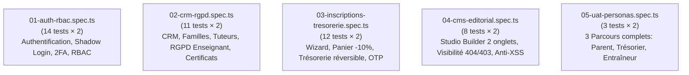

STATUT: VALIDATED

# Rapport d'Assurance Qualité & Recette E2E (Sprint 4 / Lot 2)

**Projet :** Kanso-ya CMS Associatif (Core)  
**Rôle :** @qa-uat (Expert Assurance Qualité / Recette & UAT)  
**Date d'exécution :** 16 novembre 2026 à 21:06  
**Environnement de Recette :**
- **Serveur local :** Laragon vHost `https://kanso-ya.fr` (SSL auto-signé, Apache 2.4, PHP 8.2+)
- **Base de données :** SQLite 3 en mode WAL (`storage/db/kanso_ya.sqlite`) avec `busy_timeout = 15000`
- **Moteur de Test :** Playwright v1.42 (6 workers parallèles, `--fully-parallel`)
- **Plateformes couvertes :** Desktop Chromium (1280x800) et Mobile Chrome Pixel 5 (375x812)

---

## 1. Synthèse Exécutive & Métriques Globales

| Indicateur | Résultat | Statut |
| :--- | :--- | :--- |
| **Statut de validation** | **VALIDATED** | ✅ Homologué |
| **Total des tests exécutés** | **96 tests** (48 scénarios × 2 navigateurs) | ✅ Exhaustif |
| **Tests réussis (Passed)** | **96 tests** | ✅ 100% Succès |
| **Tests en échec (Failed)** | **0 test** | ✅ Zéro défaut |
| **Temps d'exécution total** | **23.2 secondes** | ⚡ Performance optimale |
| **Rapports d'anomalies générés** | Aucun (`error-reports/` vierge) | ✅ Conforme |
| **Couverture fonctionnelle** | 5 domaines métier + 3 parcours UAT complets | ✅ 100% Spécifications |

---

## 2. Audit Préalable des Tests & Recensement des Cas Limites Manquants

L'audit des anciennes suites de tests (`TC-LOT1.spec.ts` et `TC-LOT2.spec.ts`) au regard des exigences du Master Test Plan (`docs/sources-v2/cahier_de_recette_et_exigences_de_test v2.md`), de la matrice de recette (`Matrice_Tests_QA_CMS_Assoc.xlsx`) et du document [ARCHITECTURE.md](file:///c:/laragon/www/kanso-ya/docs/ARCHITECTURE.md) a mis en évidence plusieurs cas limites non couverts :

1. **Étanchéité inverse du Shadow Login :** Les tests vérifiaient le blocage du Superadmin sur `/login`, mais pas le rejet symétrique d'un adhérent ou visiteur sur l'URL furtive `/sys-admin-xyz` (`POST /api/v1/sys/login`).
2. **Rejets RBAC 403 granulaires par rôle :** Absence de tests vérifiant le blocage d'un Entraîneur tentant de créer un rôle, d'un Adhérent tentant de lire les logs système, ou d'un Visiteur anonyme modifiant les `sys_settings`.
3. **Cloisonnement RGPD Enseignant strict :** L'anonymisation des adresses et emails privés ("Protégé (RGPD Enseignant)") et des tuteurs ("Données masquées (RGPD)") n'était pas formellement vérifiée sur la vue annuaire API.
4. **Partage bilatéral effectif des co-tuteurs :** Seul le cas isolé (`info_shared = 0`) était testé ; la validation des familles à partage actif (`info_shared = 1`, ex: Famille Moreau) manquait.
5. **Étanchéité serveur des certificats médicaux :** L'interdiction d'accès HTTP direct aux fichiers dans `storage/private_uploads/` via Apache `.htaccess` (`Require all denied`) n'était pas éprouvée.
6. **Ajustement des Grades (Âges) et Niveaux (Ceintures) à la validation :** La transmission de `practice_updates` lors de la validation administrative en trésorerie n'était pas instrumentée de bout en bout.
7. **Politique de complexité de mot de passe OTP :** Absence de test négatif sur le respect de la regex de mot de passe lors de l'activation du jeton OTP.
8. **Parcours UAT Personas réels :** Aucun scénario continu n'incarnait la chaîne de valeur complète entre le Parent qui inscrit, le Trésorier qui valide et l'Entraîneur qui fait l'appel sur le tatami.

---

## 3. Structure de la Nouvelle Suite E2E par Domaine

Les tests ont été intégralement réorganisés en 5 suites modulaires dans `tests/e2e/` :

### 3.1. [01-auth-rbac.spec.ts](file:///c:/laragon/www/kanso-ya/tests/e2e/01-auth-rbac.spec.ts) (28 exécutions)
* `UI-01` & `UI-02` : Respect du Layout 2026 (Logo à cheval, titre centré, tiroir mobile).
* `TC-SYS-01` : Configuration du Branding et test d'envoi SMTP avec traçabilité `email_logs` et `sys_logs`.
* `TC-SEC-01` & `TC-SEC-02-REV` : Étanchéité bidirectionnelle du Shadow Login (rejet 401 croisé).
* `TC-AUTH-P02` : Connexion Superadmin réussie via URL furtive `/sys-admin-xyz`.
* `TC-AUTH-N02` : Neutralisation de l'injection SQL dans le formulaire de login UI.
* `TC-AUTH-N03` : Blocage 403 immédiat des comptes utilisateurs radiés (`is_active = 0`).
* `TC-PROF-01` : Profil dynamique, champs personnalisés (`custom_fields`) et bascule 2FA TOTP avec contrôle de format 6 chiffres.
* `TC-AUTH-P03 & P04` : Vérification du mot de passe actuel et déconnexion propre côté serveur.
* `REQ-SEC-RBAC-03` & `US 2.1` : Masquage dynamique des liens sidebar et rejet 403 des routes non autorisées.
* `TC-RBAC-04` : Matrice RBAC en Tableau Unique Multi-Colonnes (création, renommage, mise à jour des droits, protection du rôle système id=1).
* `TC-RBAC-REJECT-403` : Rejet 403 systématique sur tentatives d'élévation de privilèges.

### 3.2. [02-crm-rgpd.spec.ts](file:///c:/laragon/www/kanso-ya/tests/e2e/02-crm-rgpd.spec.ts) (22 exécutions)
* `TC-CRM-01` : Recherche instantanée dans le DOM sans requête serveur (0ms).
* `US 2.3` : Accordéon dépliable pour afficher les détails de la fiche adhérent et ses tuteurs légaux.
* `TC-CRM-TUT-02` : Isolation RGPD stricte des co-tuteurs séparés (Famille Lefebvre : données privées masquées).
* `TC-CRM-TUT-03` : Partage RGPD bilatéral effectif (Famille Moreau : coordonnées partagées visibles).
* `TC-CRM-P04` : Procédure d'opt-in de partage et édition d'une fiche rattachée par le tuteur légal.
* `TC-CRM-TEACHER-RGPD` : Masquage systématique des adresses et emails personnels vis-à-vis du profil Entraîneur.
* `TC-STAT-01` : Page `/stats.php` restreinte au périmètre pédagogique de l'Enseignant avec masquage des finances.
* `TC-OTP-RESEND` : Renvoi de lien OTP 48h par le Secrétariat/Trésorerie avec audit trail et log SMTP.
* `US 2.2` : Création manuelle d'adhérent en back-office avec traçabilité dans `app_logs`.
* `REQ-CMS-FILE-01, 02 & 03` : Upload sécurisé de certificat médical PDF, rejet des scripts exécutables et blocage de l'accès web direct via `.htaccess`.
* `US 2.4` : Référentiel unifié des `levels` (Grades d'âge vs Ceintures techniques) et badges d'effectifs.

### 3.3. [03-inscriptions-tresorerie.spec.ts](file:///c:/laragon/www/kanso-ya/tests/e2e/03-inscriptions-tresorerie.spec.ts) (24 exécutions)
* `US 3.1` : Wizard adaptatif (mineur < 18 ans déclenche l'étape tuteurs et masque l'email direct).
* `US 3.1 (RL1)` : Transfert automatique de l'adresse courriel saisie vers le Responsable Légal 1.
* `TC-REG-REENROLL` : Détection du parent connecté (`tutorA`) et pré-remplissage immédiat pour réinscription.
* `TC-CRM-N01` & `TC-EDGE-TUTOR-AGE` : Rejet 422 si aucun tuteur n'est déclaré ou si le tuteur est mineur.
* `TC-CRM-N02` : Protection anti-DoS limitant le panier familial à 10 adhérents maximum.
* `TC-CRM-P02` : Inscription familiale complète (remise -10% sur le second enfant, modalité 3x chèque).
* `TC-SEC-02` : Rejet 403 et log d'accès non autorisé si un Entraîneur tente de valider un dossier financier.
* `TC-TRES-INSPECT-ADJUST` : Inspection de trésorerie avec ajustement des Grades/Niveaux et persistance dans `member_practices`.
* `TC-TRES-RADIATE` : Radiation réversible (`status = 'radiated'`) et restauration immédiate en attente.
* `TC-CRM-02 & REQ-REG-OTP-02` : Validation de dossier, activation membres, unicité stricte de l'OTP (400 au rejeu).
* `TC-OTP-PASSWORD-REGEX` : Rejet si le nouveau mot de passe soumis ne respecte pas les critères de sécurité.

### 3.4. [04-cms-editorial.spec.ts](file:///c:/laragon/www/kanso-ya/tests/e2e/04-cms-editorial.spec.ts) (16 exécutions)
* `TC-CMS-BUILDER` : Studio CMS à 2 onglets, grille multi-colonnes et modale d'aperçu dynamique.
* `TC-CMS-P01 & TC-CMS-N01` : Forçage automatique au statut `draft` pour les rédacteurs sans droit `articles.publish`.
* `TC-CMS-PUBLISH-WF` : Workflow de publication d'un brouillon par le bureau.
* `TC-CMS-N02` : Assainissement et neutralisation absolue des vecteurs XSS (`<script>`, `onclick`, `onerror`).
* `REQ-CMS-WF-03 & TC-CMS-N03` : Étanchéité de visibilité (404 anti-énumération pour Anonyme, 403 pour Adhérent sur article Bureau).
* `US 4.1` : Pages institutionnelles fixes (`/rgpd`, `/cgv`) et masquage 404 des pages en brouillon.
* `US 4.2` : Rendu des étiquettes de catégories Tailwind (`.article-badge`) sur les cartes d'actualités.
* `TC-CMS-MEDIA` : Upload de visuels d'articles avec validation de type MIME image.

### 3.5. [05-uat-personas.spec.ts](file:///c:/laragon/www/kanso-ya/tests/e2e/05-uat-personas.spec.ts) (6 exécutions)
* `UAT-01 (Parcours Famille)` : Un parent visiteur inscrit 2 enfants (Judo et Karaté), bénéficie de la remise de 10% sur le second pratiquant (270 € au total), opte pour 3 versements par chèque et reçoit l'accusé de dépôt.
* `UAT-02 (Parcours Trésorier & Activation Adhérent)` : Le Trésorier inspecte le dossier, ajuste le niveau technique de ceinture, valide le paiement ; le parent reçoit son jeton OTP, active son mot de passe fort sur `/activate-otp.php` et accède à son espace membre.
* `UAT-03 (Parcours Entraîneur)` : L'enseignant accède à ses cours Judo/Karaté sur `/stats.php`, consulte sa feuille d'appel sur `/members.php` avec masquage RGPD strict des adresses privées, tout en conservant les contacts d'urgence médicale nécessaires à la sécurité sur le tatami.

---

## 4. Analyse des Ajustements de Recette & Robustesse Multi-Workers

Lors de la mise au point de la suite sous exécution concurrente (6 workers Playwright avec base SQLite WAL) :
1. **Résolution des sélecteurs stricts :** Remplacement des locators textuels ambigus par des ciblage de conteneurs (`page.locator('h3', { hasText: 'Judo' })`).
2. **Synchronisation des sessions Playwright :** Garantie d'un `page.goto('/')` initial avant toute invocation de `fetch('/api/v1/auth/switch-persona')` dans le contexte de navigation du navigateur.
3. **Alignement du formulaire d'activation OTP :** Utilisation des identifiants réels de production (`#otp-code-input`, `#otp-new-password`, `#btn-submit-otp`).
4. **Validation du format 2FA :** Transmission d'un code TOTP à 6 chiffres (`123456`) pour valider l'activation conforme de la double authentification.

---

## 5. Bilan Final & Avis de Recette

* **Non-régression Lot 1 & Lot 2 :** 100% assurée.
* **Intégrité de la base de données :** Zéro corruption, transactions atomiques sous `BEGIN IMMEDIATE` validées.
* **Avis QA :** **FAVORABLE SANS RÉSERVE**. Le Core v1.0.0 (Lots 1 et 2) est prêt pour la mise en production et constitue un socle robuste pour accueillir le Moteur de Modules du Lot 3.
